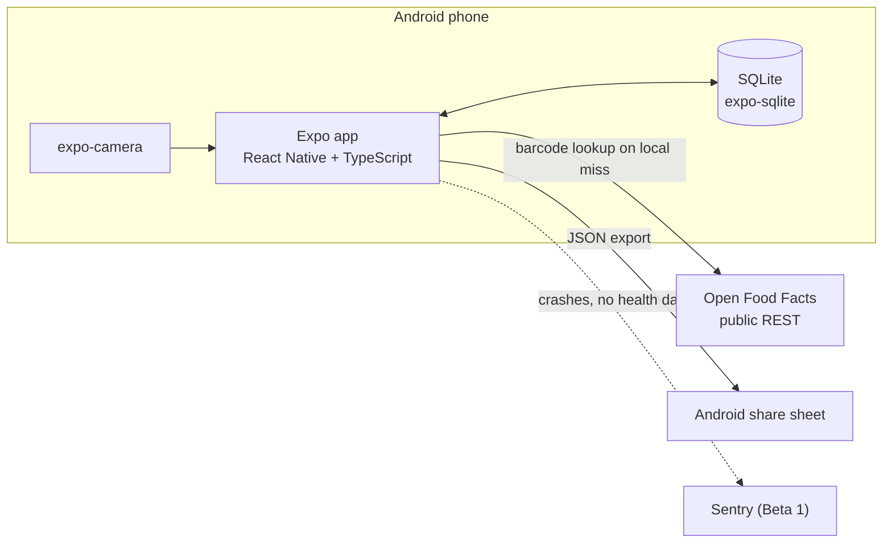
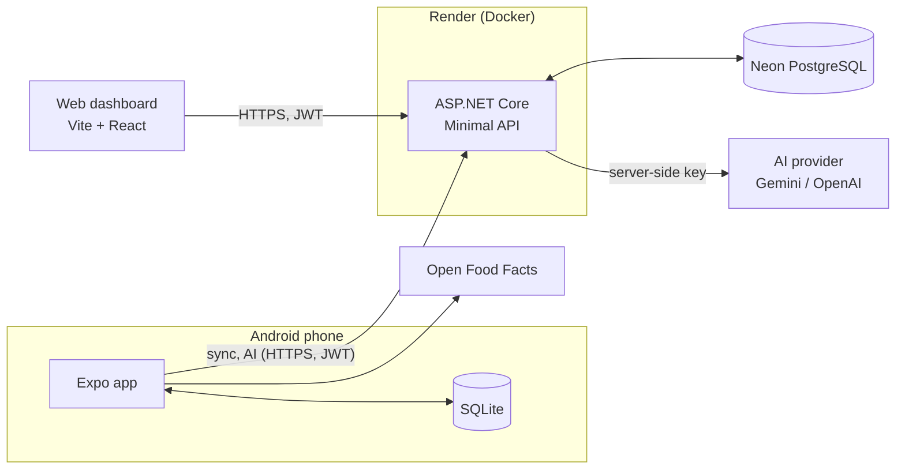
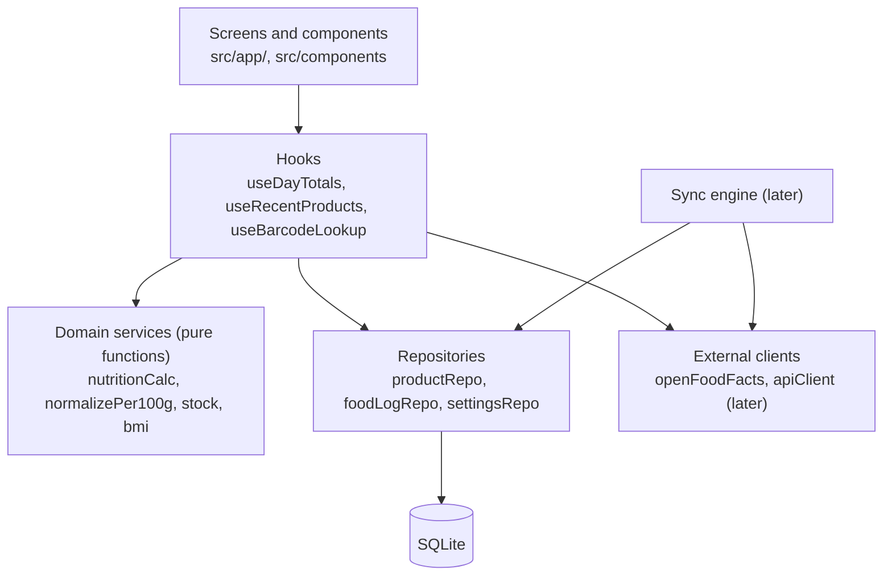
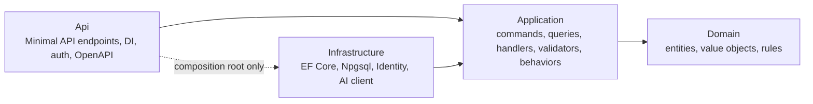

# Architecture

**Date:** October 20, 2026
**Status:** Draft. Reflects locked sprint decisions plus the Expo → .NET API → PostgreSQL direction from `tech_lead/01` (ADR-14 to ADR-18 still *Proposed*)
**Related:** [05 architecture outline and ADR log](./plan/05_architecture_outline.md) · [Database](./DATABASE.md) · [API](./API.md) · [Security](./SECURITY.md) · [Tools](./tech_lead/02_tools_and_services.md)

> `05_architecture_outline.md` §2 and §7-§10 still describe Supabase and Edge
> Functions (finding #2 in `tech_lead/01` §8). This document uses the newer .NET
> direction. The ADR log in `05` §13 stays the record of decisions.

---

## 1. Shape of the system

### Now: v1 and Friends Beta 1

Everything runs on the phone. No server, no account.



### Later: Beta 2 (December onward)

One API, two clients. The phone stays fully usable offline.



## 2. Mobile app layers

Screens never touch SQLite or the network directly.



| Layer | Owns | Rules |
|-------|------|-------|
| Screens | Layout, navigation, form wiring | No SQL, no `fetch`. Thin route files in `src/app/` |
| Hooks | Loading and error state, composing services and repos | One concern each; reusable across screens |
| Domain services | Calculations and normalization | Pure and synchronous where possible. **These are unit-tested** |
| Repositories | All SQL, mapping rows to types | Parameterized queries only; return typed objects; set `updated_at` |
| External clients | HTTP to Open Food Facts and, later, the API | Timeouts; responses parsed with `zod` |

.NET comparison for the owner: repositories are the repository pattern without DI containers. Modules import them directly, and tests mock them with Jest.

## 3. Modules

| Module | Owns | Reads but never writes |
|--------|------|------------------------|
| **nutrition** | products, food_log_entries, goal settings | - |
| **pantry** (v1.1) | pantry_items, stock_movements, recipes, batches | products |
| **progress** (v1.1) | body_profile, weight entries, measurements; BMI, trend, TDEE | food_log_entries |
| **workouts** (later) | exercises, workout_sessions, workout_sets | - |
| **shared** | settings, theme, backup, migrations, sync, API client | domain rules |

Pantry rule (ADR-8): only `food_log_entries` count toward daily totals. Eating from the pantry writes one log entry and one `eaten` movement in a single transaction.

## 4. Folder structure

The repo is a monorepo. Each app is its own project with its own config, under `apps/`:

```text
apps/
├── mobile/                  # Expo app (v1 onward)
├── web/                     # Vite React dashboard (later, feature 23)
└── api/                     # ASP.NET Core Minimal API (later, feature 16)
1_docs/  blueprint/  specs/  # planning and workflow, outside the apps
```

Only `apps/mobile` exists until the web and API phases start. No npm workspaces until code is shared between apps.

Inside `apps/mobile/` (every `src/` path in the docs is relative to this folder):

```text
src/
├── app/                     # Expo Router routes only (thin)
│   ├── _layout.tsx          # root stack
│   ├── (tabs)/
│   │   ├── _layout.tsx      # tab bar
│   │   ├── index.tsx        # Today
│   │   ├── log.tsx
│   │   ├── products.tsx
│   │   └── settings.tsx
│   ├── scan.tsx
│   ├── product/[id].tsx
│   └── add/[productId].tsx
├── components/              # shared UI (CalorieSummary, EntryRow, ...)
├── modules/
│   ├── nutrition/
│   │   ├── components/
│   │   ├── hooks/
│   │   ├── repositories/    # productRepo.ts, foodLogRepo.ts
│   │   ├── services/        # nutritionCalc.ts (+ .test.ts)
│   │   └── types/
│   ├── pantry/              # v1.1
│   ├── progress/            # v1.1
│   └── workouts/            # later
├── db/
│   ├── client.ts            # open database, run migrations
│   └── migrations/          # 001_init.ts, 002_..., additive only
├── lib/
│   ├── theme/               # tokens, useTheme (see DESIGN_SYSTEM.md)
│   ├── openFoodFacts.ts
│   └── dates.ts             # date-fns helpers, local day keys
└── sync/                    # later
assets/
```

The API and web dashboard live in this repo under `apps/api/` and `apps/web/`. Their internal layout is set when those features are specced.

## 5. Key runtime decisions

| Concern | Decision | Source |
|---------|----------|--------|
| Storage | `expo-sqlite`, local only for v1 and Beta 1 | `08` §1, ADR-2, ADR-13 |
| IDs | UUID v4 from `expo-crypto` `randomUUID()` | `tech_lead/02` §4 |
| Time | Store UTC ISO timestamps; also store the local day key (`YYYY-MM-DD`) on log entries for grouping | `05` §11 |
| Migrations | Runner keyed on `PRAGMA user_version`; additive only; export before each | `tech_lead/01` §8 #6 |
| Nutrition math | Per 100 g; entries keep copies | ADR-6 |
| Pantry | Stock is a ledger | ADR-7, ADR-8 |
| Forms | `react-hook-form` + `zod` | `08` §1 |
| State | Hooks + context; `zustand` only if context gets messy | `tech_lead/02` §4 |
| Server data (later) | TanStack Query in app and web; types from OpenAPI via `openapi-typescript` | `tech_lead/02` §6 |
| Sync (later) | Push pending rows, pull `updated_at > last_sync`, last-write-wins, soft delete via `deleted_at` | ADR-4, ADR-16 |
| AI (later) | Only through the API; parse → preview → confirm | ADR-5 |
| Platform code | Behind interfaces (e.g. `healthService`) so iOS is a switch, not a rewrite | ADR-12 |

## 6. Backend (later)

| Part | Choice |
|------|--------|
| Runtime | ASP.NET Core Minimal API on .NET 10 LTS |
| Structure | Clean Architecture + CQRS with MediatR (ADR-21) |
| Data | EF Core + Npgsql; additive migrations |
| Validation | FluentValidation, run by a MediatR pipeline behavior |
| Auth (Beta 2) | ASP.NET Core Identity API endpoints + JWT bearer |
| AI | `Microsoft.Extensions.AI`, with resilience (retries, timeouts) and per-user rate limits |
| Docs | OpenAPI + Scalar page (public, portfolio) |
| Logging | Serilog, no request bodies |
| Health | `GET /health` for Render |

### Layers (ADR-21)



| Project | Holds | Depends on |
|---------|-------|------------|
| `MyFitnessTrackingApp.Domain` | Entities, value objects, domain rules (per-100 g math, LWW comparison) | Nothing |
| `MyFitnessTrackingApp.Application` | `Features/<Area>/<UseCase>/`: command or query, handler, validator, DTOs. Interfaces for outside services (`IAppDbContext`, `IAiClient`, `ICurrentUser`). Pipeline behaviors (validation, logging) | Domain |
| `MyFitnessTrackingApp.Infrastructure` | `AppDbContext`, EF configurations and migrations, Identity, AI and HTTP clients | Application |
| `MyFitnessTrackingApp.Api` | Endpoint groups that map HTTP to `ISender.Send(...)`, auth, Problem Details, OpenAPI, DI wiring | Application, Infrastructure (wiring only) |

CQRS rules:

- **Commands** change state and return an id or nothing. **Queries** read only, with `AsNoTracking()` and projection straight to DTOs.
- One PostgreSQL database for both. CQRS here splits the code, not the storage. No read replicas, event sourcing, or message bus.
- Handlers use `IAppDbContext` directly. No generic repository on top of EF Core.
- Endpoints stay one line: bind the request, send it, map the result to HTTP.
- `userId` always comes from `ICurrentUser`, never from the request body.

Contracts: [API.md](./API.md).

## 7. Build, test and deploy

| Stage | Tooling |
|-------|---------|
| Dev | Expo Go on the physical phone; EAS dev build if the camera needs it |
| Quality | TypeScript strict, ESLint, Prettier; Jest (`jest-expo`) for services |
| CI (Nov) | GitHub Actions: typecheck, lint, test. Run `/ci` to set up |
| App release | EAS Build preview profile → APK → GitHub Releases; EAS Update for JS-only fixes; same EAS keystore always |
| API release (Dec) | Render auto-deploy from `main`; Neon Postgres; secrets in Render env |
| Web release (Jan) | Vercel or Cloudflare Pages Git integration |

## 8. Quality attributes

| Attribute | How the architecture supports it |
|-----------|----------------------------------|
| Offline | Local DB is the source of truth; network is optional everywhere |
| Data safety | Copies on log entries, ledger for stock, additive migrations, export |
| Testability | Pure domain services; repositories are the only SQL boundary |
| Evolvability | Repositories hide storage, so sync slots in behind them |
| Privacy | No server until Beta 2; see [SECURITY.md](./SECURITY.md) |

## 9. Open decisions

- Repo layout for the API and the web dashboard.
- Accept ADR-2 to ADR-5 and ADR-14 to ADR-18.
- `drizzle-orm` after v1, or keep hand-written SQL.
- Update `05` §2 and §7-§10 to remove Supabase (Q-T3).
