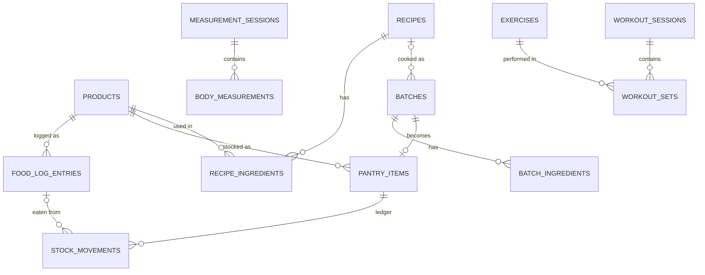
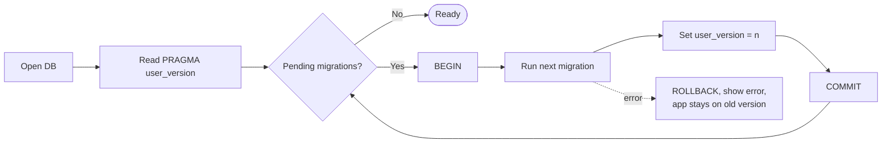
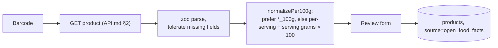

# Database

**Date:** October 20, 2026
**Status:** Draft. v1 schema is ready to implement in feature 1; later tables are designs to confirm in their feature specs
**Related:** [Architecture](./ARCHITECTURE.md) · [03 §4 entities](./plan/03_fitness_app_outline.md) · [09 §5 pantry](./plan/09_pantry_inventory.md) · [10 §8 body](./plan/10_body_progress.md) · [ER diagram (BA)](./business_analyst/user_story/04_recipes_and_pantry.md)

---

## 1. Rules

| # | Rule | Why | ADR |
|---|------|-----|-----|
| D1 | Every table has `id` (UUID text), `created_at`, `updated_at` | Sync and pantry movements need stable ids and change times | ADR-16 |
| D2 | Synced tables have `deleted_at` (soft delete) | Deletes on the phone must reach the server | ADR-16 (*Proposed*) |
| D3 | Product nutrition is **per 100 g** | Pantry, batches and portions all work in grams | ADR-6 |
| D4 | Log entries **copy** kcal/P/C/F at log time | Product edits never rewrite history | ADR-6 |
| D5 | Pantry stock = sum of `stock_movements` | History, undo, waste report | ADR-7 |
| D6 | Stock never affects daily totals | Buying isn't eating | ADR-8 |
| D7 | Body data in kg and cm; BMI, trends, TDEE calculated | One source of truth | ADR-9 |
| D8 | Migrations are additive only | Real data on real phones | `08` §7 |
| D9 | Timestamps are UTC ISO 8601 text; log entries also store the local day key | Group by the user's day, not UTC | `05` §11 |
| D10 | snake_case tables and columns; booleans are `INTEGER` 0/1 | SQLite has no boolean | - |

## 2. Entity overview



| Group | Tables | Feature |
|-------|--------|---------|
| Nutrition (v1) | `products`, `food_log_entries`, `settings` | 1-3 |
| Pantry (v1.1) | `pantry_items`, `stock_movements`, `recipes`, `recipe_ingredients`, `batches`, `batch_ingredients` | 8-12 |
| Body (v1.1+) | `body_profile`, `body_weight_entries`, `import_runs`, `measurement_sessions`, `body_measurements` | 11, 20, 22 |
| Workouts (later) | `exercises`, `workout_sessions`, `workout_sets` | 19 |
| Sync (later) | `sync_queue`, `sync_state` | 17 |

## 3. v1 schema (SQLite)

Migration `001_init`. Column lists come from `03` §4, `08` Oct 20 and `09` §3.

```sql
CREATE TABLE products (
  id                TEXT PRIMARY KEY,           -- UUID
  barcode           TEXT,                        -- null for manual items
  name              TEXT NOT NULL,
  brand             TEXT,
  serving_size      TEXT,                        -- display only, e.g. "1 can"
  serving_grams     REAL,                        -- grams in one serving, if known
  kcal_per_100g     REAL NOT NULL CHECK (kcal_per_100g >= 0),
  protein_per_100g  REAL CHECK (protein_per_100g >= 0),
  carbs_per_100g    REAL CHECK (carbs_per_100g >= 0),
  fat_per_100g      REAL CHECK (fat_per_100g >= 0),
  net_weight_g      REAL,                        -- reserved for pantry
  source            TEXT NOT NULL CHECK (source IN ('manual','open_food_facts','ai_estimate')),
  is_favorite       INTEGER NOT NULL DEFAULT 0,
  created_at        TEXT NOT NULL,
  updated_at        TEXT NOT NULL,
  deleted_at        TEXT
);
CREATE UNIQUE INDEX ux_products_barcode ON products(barcode)
  WHERE barcode IS NOT NULL AND deleted_at IS NULL;
CREATE INDEX ix_products_name ON products(name COLLATE NOCASE);

CREATE TABLE food_log_entries (
  id            TEXT PRIMARY KEY,
  day           TEXT NOT NULL,                   -- local day key 'YYYY-MM-DD'
  logged_at     TEXT NOT NULL,                   -- UTC timestamp
  meal_type     TEXT NOT NULL CHECK (meal_type IN ('breakfast','lunch','dinner','snack')),
  product_id    TEXT REFERENCES products(id),
  product_name  TEXT NOT NULL,                   -- copy, so history reads without the product
  grams         REAL NOT NULL CHECK (grams > 0),
  kcal_per_100g     REAL NOT NULL,               -- copies at log time (ADR-6)
  protein_per_100g  REAL,
  carbs_per_100g    REAL,
  fat_per_100g      REAL,
  kcal          REAL NOT NULL,                   -- = kcal_per_100g * grams / 100
  protein_g     REAL,
  carbs_g       REAL,
  fat_g         REAL,
  notes         TEXT,
  created_at    TEXT NOT NULL,
  updated_at    TEXT NOT NULL,
  deleted_at    TEXT
);
CREATE INDEX ix_log_day ON food_log_entries(day) WHERE deleted_at IS NULL;
CREATE INDEX ix_log_product_recent ON food_log_entries(product_id, logged_at);

CREATE TABLE settings (
  key         TEXT PRIMARY KEY,                  -- e.g. 'calorie_goal_kcal'
  value       TEXT NOT NULL,                     -- JSON-encoded
  updated_at  TEXT NOT NULL
);
```

Notes:

- Storing the per-100 g copies on the entry lets an edit to grams rescale from the entry itself (UX_FLOWS §5).
- `settings` as key/value is *Proposed*. The alternative is `daily_nutrition_goals` with an `effective_date` (`03` §4), which keeps old goals for history. Decide in feature 3.
- Meal types are fixed in v1. Custom slots (story B2) would need a `meal_slots` table (PRD Q1).

### Common queries

| Purpose | Query shape |
|---------|-------------|
| Day totals | `SELECT meal_type, SUM(kcal), SUM(protein_g) ... FROM food_log_entries WHERE day = ? AND deleted_at IS NULL GROUP BY meal_type` |
| Recents | `SELECT product_id, MAX(logged_at) FROM food_log_entries WHERE logged_at >= ? AND deleted_at IS NULL GROUP BY product_id ORDER BY 2 DESC LIMIT 12` |
| Search | `SELECT ... FROM products WHERE deleted_at IS NULL AND name LIKE '%' || ? || '%' COLLATE NOCASE ORDER BY is_favorite DESC, name LIMIT 50` |
| Barcode | `SELECT ... FROM products WHERE barcode = ? AND deleted_at IS NULL` |

All queries use bound parameters. Never build SQL from strings.

## 4. Later schema (designs)

Fields from `09` §5, `10` §8 and `03` §4. Every table also gets `id`, `created_at`, `updated_at`, `deleted_at`.

### Pantry (features 8-12)

| Table | Columns |
|-------|---------|
| `pantry_items` | `kind` (`packaged`/`supplement`/`batch`), `product_id?`, `batch_id?`, `status` (`sealed`/`opened`/`active`/`finished`/`discarded`/`expired`), `location` (`fridge`/`freezer`/`cupboard`), `opened_at?`, `expires_at?` |
| `stock_movements` | `pantry_item_id`, `occurred_at`, `delta_units?`, `delta_grams`, `reason` (`bought`/`cooked`/`eaten`/`used_in_cooking`/`shared`/`discarded`/`spilled`/`adjustment`), `food_log_entry_id?`, `batch_id?` |
| `recipes` | `name`, `notes`, `learned_cooked_ratio` |
| `recipe_ingredients` | `recipe_id`, `product_id`, `raw_grams`, `is_estimated` |
| `batches` | `recipe_id?`, `cooked_at`, `cooked_weight_g`, `weight_method` (`weighed_parts`/`settled`/`estimated`), `is_settled`, kcal/P/C/F per 100 g |
| `batch_ingredients` | `batch_id`, `product_id`, `raw_grams`, copied per-100 g values, `is_estimated` |

Additions to existing tables: `products` gets `label_basis`, `eaten_drained`, drained kcal/P/C/F per 100 g, `usual_drained_g`, `track_in_pantry`. `food_log_entries` gets `pantry_item_id?` and `updated_by_settle`.

### Body (features 11, 20, 22)

| Table | Columns |
|-------|---------|
| `body_profile` (one row) | `height_cm`, `sex`, `birth_date`, `activity_level`, `goal` (`cut`/`maintain`/`bulk`), `bmi_scale` (`asia_pacific`/`who`), `tracked_sites` |
| `body_weight_entries` | `measured_at`, `weight_kg`, `source` (`manual`/`health_connect`/`apple_health`/`csv_import`), `source_record_id?`, `is_daily_value`, `body_fat_pct?`, `muscle_kg?`, `water_pct?`, `note` |
| `import_runs` | `source`, `file_name?`, `started_at`, `found`, `added`, `skipped` |
| `measurement_sessions` | `measured_on`, `note`, `photo_uris?` (device only, ADR-10) |
| `body_measurements` | `session_id`, `site`, `side` (`left`/`right`/`none`), `value_cm`, `state` (`relaxed`/`flexed`) |

### Workouts (feature 19)

| Table | Columns |
|-------|---------|
| `exercises` | `name`, `muscle_group?`, `equipment?`, `guide_id?` (Workout Guide id, e.g. `push-up`, ADR-20) |
| `workout_sessions` | `started_at`, `ended_at?`, `name?`, `notes?` |
| `workout_sets` | `session_id`, `exercise_id`, `set_number`, `reps?`, `weight_kg?`, `duration_sec?`, `rpe?` |

## 5. Migrations



- Files: `src/db/migrations/NNN_name.ts`, each exporting `up(db)`. No `down`; fixes roll forward.
- Allowed: `CREATE TABLE`, `ADD COLUMN` (nullable or with a default), `CREATE INDEX`, backfills.
- Not allowed: `DROP`, renaming columns, rewriting stored copies. To change a shape, add a new column, backfill it, and stop reading the old one.
- Before each new migration ships: export a backup on the device.
- Enable `PRAGMA foreign_keys = ON` at open.

## 6. Data pipelines

### Open Food Facts → library



Values that can't be normalized are left blank for the user, never guessed.

### JSON backup (export, restore)

```json
{
  "format": "myfitnesstrackingapp-backup",
  "formatVersion": 1,
  "schemaVersion": 1,
  "exportedAt": "2026-10-27T12:00:00Z",
  "tables": {
    "products": [ { "id": "…", "name": "…" } ],
    "food_log_entries": [],
    "settings": []
  }
}
```

- Export includes soft-deleted rows (so restore and sync stay consistent) and excludes photos (ADR-10).
- Restore (feature 14) validates `format` and `schemaVersion`, runs migrations on the imported data, and previews row counts before writing in one transaction.
- Exports contain health data. They're never committed (`.gitignore`) and the share sheet shows a warning.

### Xiaomi CSV import (feature 11)

Parse the CSV → map to `body_weight_entries` with `source='csv_import'` → skip duplicates by timestamp and weight → record the counts in `import_runs`, so a bad import can be undone.

### Sync (feature 17, *Proposed*)

| Step | Behavior |
|------|----------|
| Write | Local write + `sync_queue` row (`table_name`, `record_id`, `operation`, `payload`, `created_at`) in the same transaction |
| Push | Send queued rows to `POST /v1/sync/push`; remove on ack |
| Pull | `GET /v1/sync/pull?since=` per `sync_state.last_pulled_at`; upsert by `id` |
| Conflict | Last-write-wins on `updated_at` (ADR-4) |
| Delete | `deleted_at` set; purged from devices only after the server confirms |

## 7. Server database (later)

Neon PostgreSQL mirrors the SQLite tables, plus `user_id` on every user-owned table (Beta 2) and an index on `(user_id, updated_at)`. EF Core migrations follow the same additive rule. UUIDs stay client-generated, so ids match across devices.
