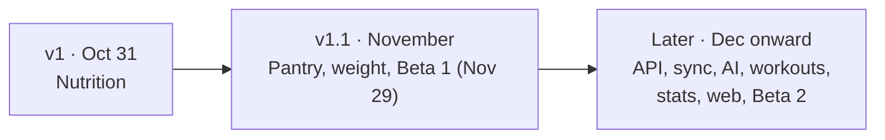

# PRD - MyFitnessTrackingApp

**Date:** October 20, 2026
**Status:** Draft. Scope follows the approved [build plan](../blueprint/build-plan.md); items marked *Proposed* still need the owner's OK
**Related:** [Project plan](../blueprint/project-plan.md) · [User stories](./business_analyst/user_story/01_user_story.md) · [October sprint](./plan/08_october_sprint.md) · [UX flows](./UX_FLOWS.md) · [Architecture](./ARCHITECTURE.md)

---

## 1. Summary

A personal, local-first Android app for tracking food, and later pantry stock,
body progress and workouts. The first release does one thing well:

> Scan a grocery barcode, save the product once with my own numbers, log it to a
> meal, and see calories remaining. Under 30 seconds, offline, every day.

## 2. Problem

| Today | Pain | What the app does instead |
|-------|------|---------------------------|
| MyFitnessPal | Cluttered with wrong and duplicate foods | My own product library; my edits win |
| ChatGPT | No memory between chats, no barcode, numbers drift | Every log is stored on the phone with a fixed copy of its values |
| Typing groceries again | The same products every week | Scan once, then recents, favorites and one-tap re-log |

## 3. Goals and non-goals

### Goals

| # | Goal | Measure |
|---|------|---------|
| G1 | Log fast | Scan to saved entry in **< 30 s**; a repeat breakfast in **≤ 3 taps** plus grams |
| G2 | Never lose data | Zero data-loss bugs from daily use starting Oct 23; JSON export works |
| G3 | Daily use | Used every day from Oct 23 to Oct 31 and after |
| G4 | Trustworthy numbers | Editing a product never changes past logs |
| G5 | Portfolio quality | Public repo with README, demo video, APK release, tests and CI (`tech_lead/01` §7) |

### Non-goals

- iOS (parked until there's budget for the $99/year Apple fee, ADR-12)
- A web app for *logging* (the January web dashboard is for reading and managing data)
- Social features, feeds, sharing between users, marketplace, ads
- Medical advice. Calorie, BMI and TDEE numbers are estimates
- Finance tracking (separate project)

## 4. Users

| User | Needs | When |
|------|-------|------|
| **Owner** | Fast daily logging of PH groceries and home food; trustworthy totals; a log that remembers | Daily from Oct 23 |
| **Beta testers** (2-5 Android friends) | Install by APK link; first-run setup with their own goal and units; their data stays on their phone | Beta 1, Nov 29 |
| **Portfolio viewer** | Understand the product and the engineering quickly | Public repo |

One user per device. No accounts until Beta 2.

## 5. Releases

| Release | Build-plan features | Theme |
|---------|---------------------|-------|
| **v1** (Oct 31) | 1-7 | Nutrition: library, food log, Today, scan, Open Food Facts, re-log, export |
| **v1.1** (November) | 8-15 | Pantry, supplements, recipes and batches, body weight and BMI, beta readiness |
| **Later** | 16-24 | .NET API, sync, AI meal parse, workouts, measurements, calorie stats, scale sync, web dashboard, accounts |

The November order (pantry before the API and workouts) is *Proposed* (`08` §6).

## 6. v1 requirements (Oct 31)

Priorities use MoSCoW. Story IDs refer to [`01_user_story.md`](./business_analyst/user_story/01_user_story.md).

### F1. Product library - Must

Stories: A1, A2, A3

- Add, edit and search products. Search matches partial names ("chick" finds "Chicken breast, boiled").
- Nutrition is entered and stored **per 100 g**: kcal (required), protein, carbs, fat (optional).
- Optional brand, barcode, display serving size and net weight.
- Every product records its source: `manual`, `open_food_facts` or `ai_estimate`.

**Acceptance:** 5 real products added by hand. A product edit is used by every *later* log.

### F2. Food log - Must

Stories: B1, B6, A5

- Log a product to a meal (breakfast, lunch, dinner, snack) on a date, with grams.
- The entry stores a **copy** of kcal, protein, carbs and fat for those grams.
- Edit the grams, or delete an entry.

**Acceptance:** a full real day logged. Editing the product afterwards doesn't change that day.

### F3. Today screen - Must

Stories: C1, C2, C3

- A calorie goal in Settings.
- Today shows eaten / goal / remaining and a subtotal for each meal.
- Over-goal state is shown clearly. It's information, not an error.

**Acceptance:** totals match a hand calculation for a logged day.

### F4. Barcode scanner - Must

Story: F1

- The camera scans EAN/UPC barcodes, with haptic feedback.
- The app looks in the local library first and opens the product on a match.
- If camera permission is denied, the user can still search or add the product manually.

### F5. Open Food Facts lookup - Must

Stories: F1, F2

- On a local miss while online, fetch from Open Food Facts, show a preview, let the user edit the values, then save to the library and log it.
- If the product isn't found, the lookup fails, or the phone is offline, open the manual form with the barcode prefilled.
- Values are normalized to per 100 g before review. Nothing is saved without review.

**Acceptance:** 10 real groceries scanned end to end. Local PH products that aren't on Open Food Facts still get logged.

### F6. One-tap re-log - Must

Story: B4

- Recent products (last 7 days) and favorites (star a product) appear first.
- Quick-add from Today.

**Acceptance:** a repeat breakfast is logged in 3 taps or fewer, plus grams.

### F7. Day navigation and JSON export - Must

Stories: C4, G1

- Previous and next day on the Log screen. Any past day shows exactly what was logged.
- Export all data as one JSON file through the Android share sheet.

**Acceptance:** the exported file opens and contains every table's rows.

### v1 stretch goals (only if Oct 30 is free)

1. Copy yesterday's meal to today (B3)
2. Show protein, carbs and fat totals on Today (data already stored)
3. Import a JSON backup (later feature 14)

## 7. v1.1 and later (summary)

Detail lives in the linked plan docs. Each feature gets a full spec through `/feature` before it's built.

| # | Feature | Key stories | Source |
|---|---------|-------------|--------|
| 8 | Pantry and groceries | L1, L2, L4, L6-L9 | `09` P1 |
| 9 | Canned and opened items | L3, L5 | `09` P2 |
| 10 | Supplements | K1-K6 | `09` P3 |
| 11 | Body weight and BMI | J1, J5, J6, J17 | `10` B1 |
| 12 | Recipes and cooked batches | M1-M8, M18, M19 | `09` P4 |
| 13 | First-run setup + formula TDEE calculator | O-series, J5, J12 (formula), J13 | `11` §4, `10` §2 |
| 14 | Backup restore | G2 | `11` §4 |
| 15 | Beta feedback and safety | O-series | `11` §4 |
| 16 | .NET API foundation | - | `tech_lead/01` |
| 17 | Sync | G3 | `05` §7 |
| 18 | AI meal parse | D1-D3 | `07`, `02_workflow` §4 |
| 19 | Workouts | H1-H4, H8 | `06` Phase 3, ADR-20 |
| 20 | Body measurements | J7-J10 | `10` B2 |
| 21 | Calorie stats + learned TDEE | J4, J11, J12 (learned), J13 | `10` B3 |
| 22 | Scale sync | J18, J19 | `10` B1b |
| 23 | Web dashboard | - | `tech_lead/01` §5 |
| 24 | Accounts (Beta 2) | O7 | `11` §2 |

**Core rule for pantry (ADR-8):** buying or cooking food never adds to daily totals. Only food log entries do.

## 8. Non-functional requirements

| Area | Requirement |
|------|-------------|
| Offline | Every logging path works with no network. Open Food Facts is optional |
| Performance | Local barcode match opens the product in < 2 s; Today renders instantly from SQLite |
| Data safety | Additive migrations only. Export before every schema change. No destructive migration ever ships |
| Privacy | Data stays on the device in v1 and Beta 1. No health data in crash reports. See [SECURITY.md](./SECURITY.md) |
| Platform | Android (current phone). Cross-platform libraries so iOS stays possible |
| Accessibility | 48 dp touch targets, readable contrast in light and dark, labels on icon buttons. See [DESIGN_SYSTEM.md](./DESIGN_SYSTEM.md) |
| Cost | $0: free tiers only |
| Correctness | Unit tests for calculation logic (totals, per-100 g scaling, remaining, stock sums) once the test runner is added |

## 9. Risks

| Risk | Mitigation |
|------|------------|
| Behind schedule (scaffold was due Oct 19) | Oct 30 buffer; cut from the bottom (export, then favorites), never the scan flow |
| Open Food Facts lacks PH products | Manual form with barcode prefilled is a Must |
| Camera fails in Expo Go | Move the EAS dev build earlier |
| Schema change breaks real data | Migration runner with `PRAGMA user_version`; export first |
| Scope creep | New ideas go to the parking lot; no features mid-sprint |

## 10. Open questions

| # | Question | Notes |
|---|----------|-------|
| Q1 | Meal slots: four fixed slots (sprint) or custom slots like Pre-Workout and Post-Workout (story B2, Must)? | v1 uses the four fixed slots. Custom slots need a decision before the design hardens |
| Q2 | Tabs: Today · Log · Products · Settings (sprint), three tabs (BA R9), or five with More (`09` §4)? | v1 uses the sprint tabs |
| Q3 | Goal storage: `settings` row or `daily_nutrition_goals` with an effective date? | Decide in feature 3 |
| Q4 | Approve the November order (pantry before the API and workouts)? | `08` §6, Q-N1 |
| Q5 | Accept ADR-2 to ADR-5 and ADR-14 to ADR-18? | `tech_lead/01` §10 |
