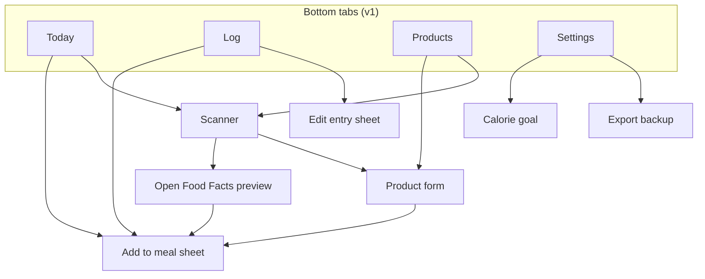
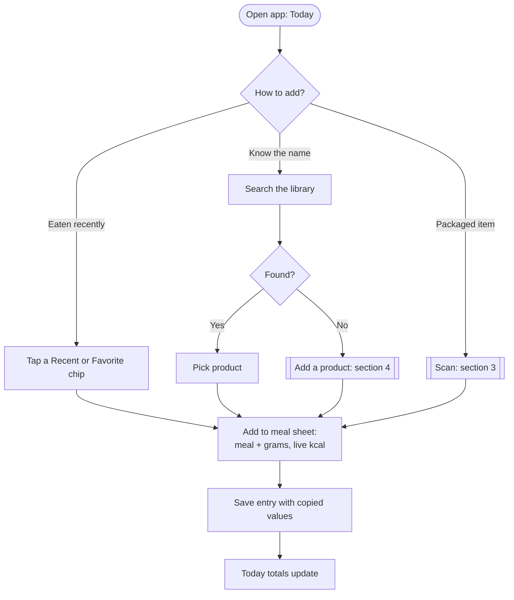
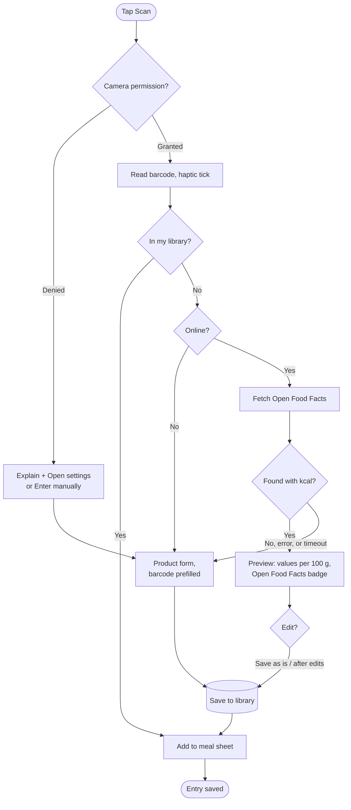
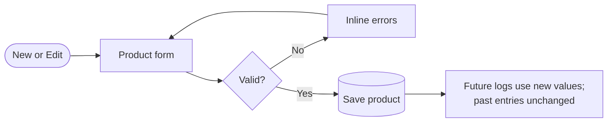
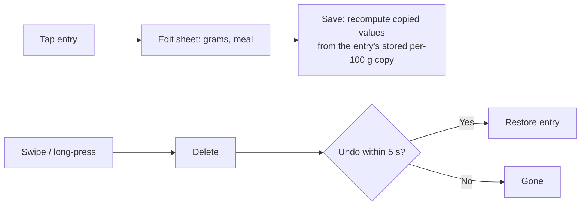

# UX Flows

**Date:** October 20, 2026
**Status:** Draft. v1 flows follow the locked sprint; later flows are summaries until their feature is specced
**Related:** [PRD](./PRD.md) · [Design system](./DESIGN_SYSTEM.md) · [Database](./DATABASE.md) · [BA workflow diagrams](./business_analyst/user_story/02_workflow_diagrams.md)

---

## 1. Screen map

| Route (Expo Router) | Screen | Feature |
|---------------------|--------|---------|
| `src/app/(tabs)/index.tsx` | Today | 3, 6 |
| `src/app/(tabs)/log.tsx` | Log (by day) | 2, 7 |
| `src/app/(tabs)/products.tsx` | Product library | 1 |
| `src/app/(tabs)/settings.tsx` | Settings | 3, 7 |
| `src/app/scan.tsx` | Scanner (full screen modal) | 4, 5 |
| `src/app/product/[id].tsx` | Product form (new or edit) | 1, 5 |
| `src/app/add/[productId].tsx` | Add to meal sheet | 2 |

Routes are relative to `apps/mobile/`. Route names are *Proposed*; final names are set in each feature spec.

## 2. Daily logging (v1)

Target: a repeat food in **≤ 3 taps plus grams**.

**Logic**

| Step | Rule |
|------|------|
| Default meal | Pre-select by time of day: before 10:30 breakfast, before 15:00 lunch, before 20:00 dinner, else snack (*Proposed*) |
| Default grams | The last grams used for this product, else its serving size in grams, else 100 |
| Save | `kcal = kcal_per_100g * grams / 100`, same for P, C, F. Values are **copied** onto the entry (ADR-6) |
| Recents | Distinct products logged in the last 7 days, newest first |

## 3. Scan to logged (v1)

Target: **< 30 s**.

| Case | Behavior |
|------|----------|
| Same barcode scanned twice quickly | Ignore reads for 2 s after a hit |
| Open Food Facts timeout | 8 s timeout, then the manual form with an `OfflineNotice` |
| Found but no kcal | Treat as not found; prefill name and brand only |
| Values per serving only | Convert to per 100 g using serving grams when present; else show the manual form with a note |

## 4. Add or edit a product (v1)

Validation: name required; kcal per 100 g required, 0-900; P, C, F optional, 0-100 each; barcode digits only, unique in the library.

## 5. Edit or delete an entry (v1)

Editing grams scales the entry's own stored values; it never re-reads the product, so history stays fixed.

## 6. Day navigation and export (v1)

- Log screen: `‹ date ›` changes the day; tapping the date opens a picker; "Today" returns.
- Settings → Export: build one JSON file (see [DATABASE.md](./DATABASE.md) §6), write it to the cache directory, open the share sheet. Show the file size and row counts on success.

## 7. Set the calorie goal (v1)

Settings → Calorie goal → number input (800-6000) → save → Today recalculates remaining. Until a goal is set, Today shows eaten only, with a "Set your goal" prompt.

## 8. Later flows (summaries)

Each becomes a full flow in its `/feature` spec.

| Flow | Feature | Summary |
|------|---------|---------|
| Add groceries to pantry | 8 | After scan or save: "Add to pantry?" → units → `bought` movement. Stock only, no calories |
| Eat from pantry | 8 | Pantry item → Eat → grams → creates a food log entry **and** an `eaten` movement in one transaction |
| Edit or delete a pantry log | 8 | Changing or deleting the entry adjusts or reverses its movement |
| Opened can | 9 | First eat from a sealed can marks it opened; grams left tracked |
| Supplement scoop | 10 | Log 30 g whey → container down 30 g; days-left estimate |
| Cook a batch | 12 | Recipe → raw grams → batch (not counted) → portions logged → settle cooked weight → per-100 g fixed |
| Log weight | 11 | Today shortcut or Progress → kg → trend and BMI update |
| First run | 13 | Goal, units, height, sex, birth date, BMI scale → app opens on Today |
| Restore backup | 14 | Pick file → validate version → preview counts → confirm → replace or merge (decide in spec) |
| AI meal parse | 18 | Paste text → API parses → preview lines matched to my products → fix unmatched → confirm → save. Nothing saved without confirm |
| Workout session | 19 | Start → pick exercise (illustration from `@bryllim/workout-guide`) → sets with "Last: 60 kg × 8" hints → finish |

See the BA diagrams for detailed pantry, supplement, paste and workout logic: [`02_workflow_diagrams.md`](./business_analyst/user_story/02_workflow_diagrams.md).

## 9. Logic map

Where each user action lands in the code and data.

| Action | Screen | Service / hook | Repository | Tables written |
|--------|--------|----------------|------------|----------------|
| Add product | Product form | `productSchema` | `productRepo.create` | `products` |
| Edit product | Product form | `productSchema` | `productRepo.update` | `products` |
| Scan hit | Scanner | `useBarcodeLookup` | `productRepo.findByBarcode` | - |
| Open Food Facts save | Preview | `openFoodFacts.fetch`, `normalizePer100g` | `productRepo.create` | `products` |
| Log food | Add to meal | `nutritionCalc.forGrams` | `foodLogRepo.create` | `food_log_entries` |
| Edit entry | Edit sheet | `nutritionCalc.rescale` | `foodLogRepo.update` | `food_log_entries` |
| Delete entry | Log | - | `foodLogRepo.softDelete` | `food_log_entries` |
| Today totals | Today | `useDayTotals`, `nutritionCalc.sum` | `foodLogRepo.listByDay` | - |
| Recents | Today | `useRecentProducts` | `foodLogRepo.recentProducts` | - |
| Favorite | Products | - | `productRepo.setFavorite` | `products` |
| Set goal | Settings | `goalSchema` | `settingsRepo.set` | `settings` |
| Export | Settings | `backupService.export` | all repos (read) | - |

Names are *Proposed* and follow [CODE_STYLE.md](./CODE_STYLE.md).
