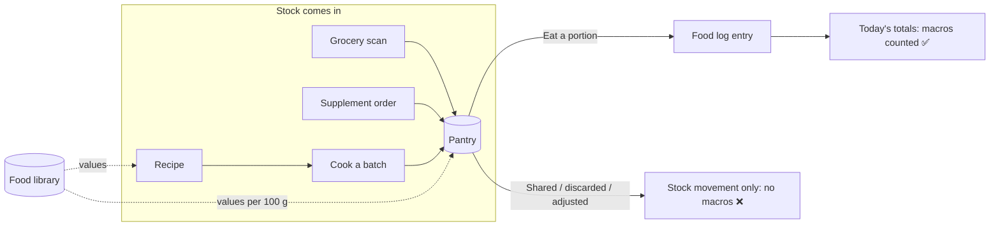
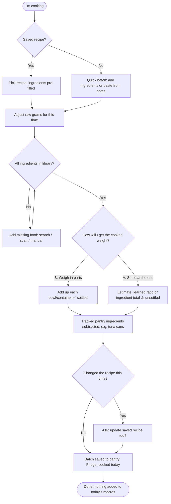
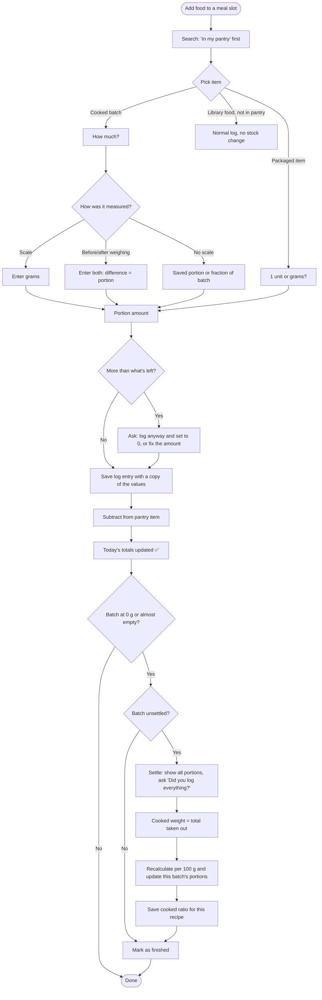
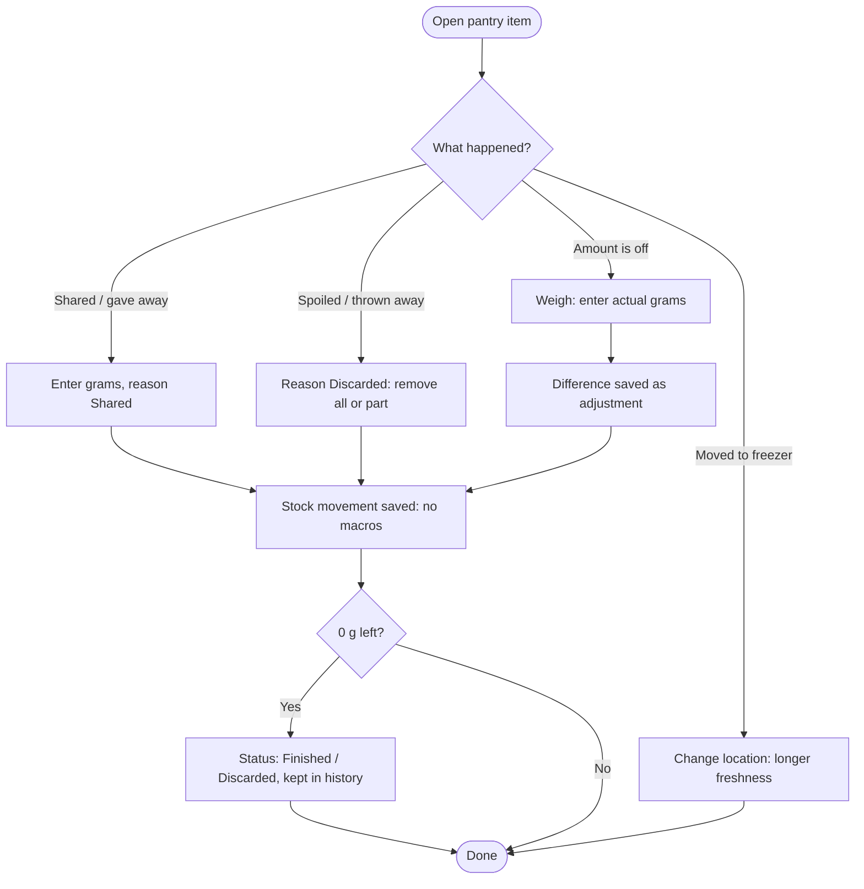
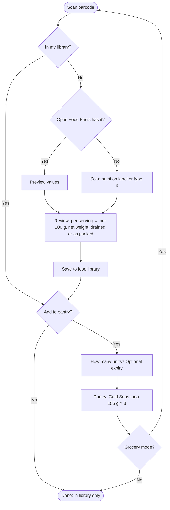
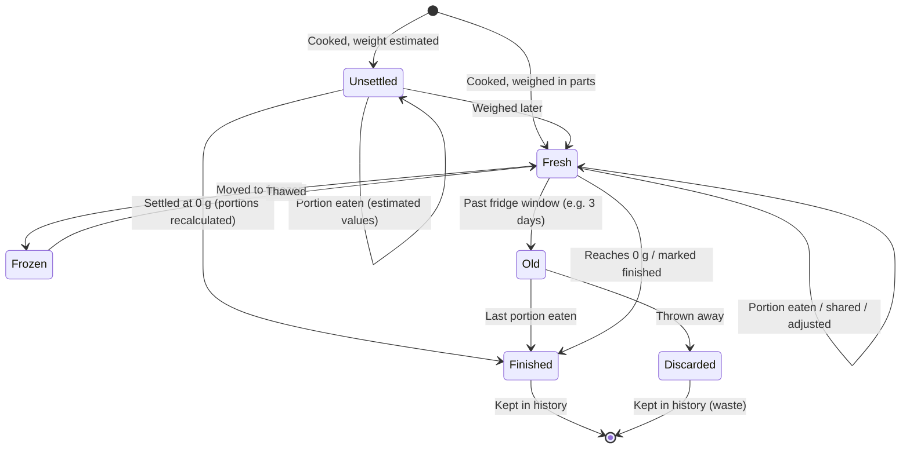
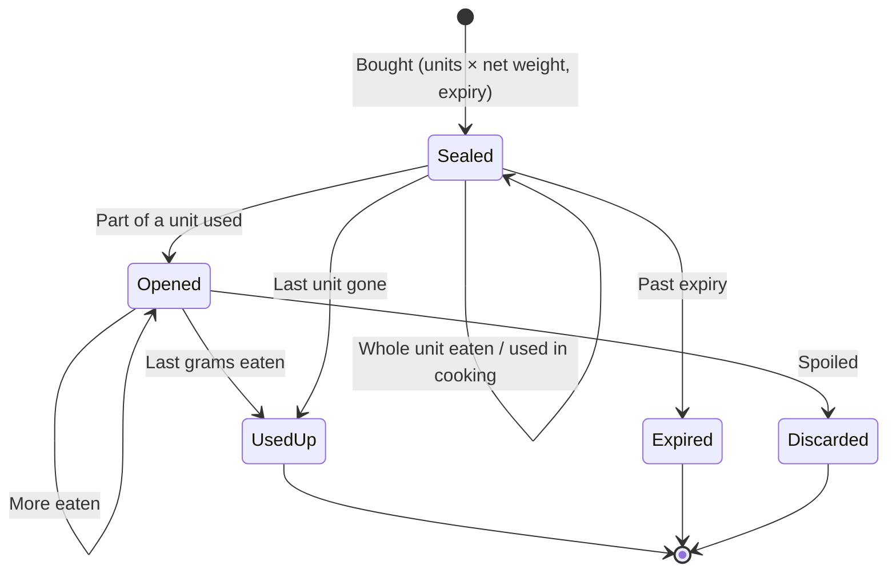
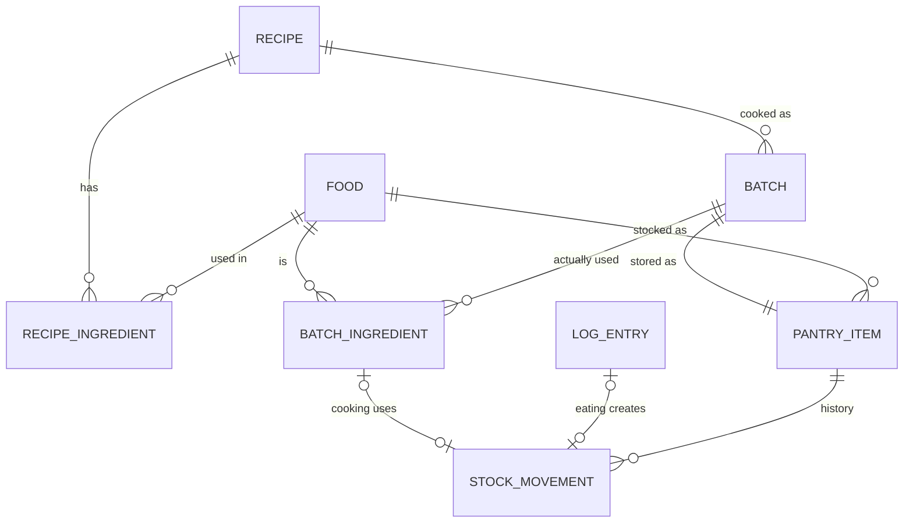

# Recipes and Pantry: Groceries, Home-Cooked Batches and Stock

**Date:** October 19, 2026
**Status:** Draft, no code · updated with the owner's answers (see [§12](#12-decisions-and-open-questions))
**Related:** [01_user_story.md](./01_user_story.md) (Epic A food library, B5 meal templates, Epic E/F scanning, Epic K supplements), [02_workflow_diagrams.md](./02_workflow_diagrams.md) (§5 supplement inventory, §8 data), [plan/08](../plan/08_october_sprint.md)

> **Viewing the diagrams:** Mermaid. Use the "Markdown Preview Mermaid Support" extension in VS Code (`Ctrl+Shift+V`).

---

## Contents

1. [What I want](#1-what-i-want)
2. [The key idea: stock is not eating](#2-the-key-idea-stock-is-not-eating)
3. [One pantry, three kinds of stock](#3-one-pantry-three-kinds-of-stock)
4. [The math: chopsuey worked example](#4-the-math-chopsuey-worked-example)
5. [The math: packaged groceries (Gold Seas tuna)](#5-the-math-packaged-groceries-gold-seas-tuna)
6. [Scenarios](#6-scenarios)
7. [Workflows](#7-workflows)
8. [User stories](#8-user-stories)
9. [Suggestions](#9-suggestions)
10. [How the data fits together](#10-how-the-data-fits-together)
11. [Impact on the plan](#11-impact-on-the-plan)
12. [Decisions and open questions](#12-decisions-and-open-questions)

---

## 1. What I want

> "I want an inventory of my food, like the recipes I cook, with the macros saved. When I cook chopsuey, I log the recipe, but it **doesn't count** toward my daily calories and macros. It's just a record of what I cooked, sitting in the fridge. When I take a **100 g portion**, that 100 g comes out of my pantry inventory."

> "When I buy something at the grocery, like **Gold Seas tuna (155 g)**, I scan the barcode and the nutrition facts, it's saved to the database, and it's **counted in my inventory**."

**Goal:** the app knows what food I *have* (fridge, cupboard, supplement shelf) separately from what I *ate*. Only eating counts toward my daily totals.

---

## 2. The key idea: stock is not eating

Every pantry action falls into one of two groups. Only one of them touches my daily macros.

| Action | Changes pantry stock? | Counts toward today's macros? |
|--------|----------------------|-------------------------------|
| Buy groceries (add 3 cans of tuna) | ➕ Yes | ❌ No |
| Cook a batch (chopsuey) | ➕ Batch added (➖ tracked ingredients used) | ❌ No |
| **Eat a portion** (100 g chopsuey, 1 can tuna) | ➖ Yes | ✅ **Yes** |
| Share with family / give away | ➖ Yes | ❌ No |
| Throw away (spoiled) | ➖ Yes | ❌ No |
| Correct the amount (weighed, count was off) | ± Yes | ❌ No |
| Log a food that isn't in the pantry (taho from the vendor) | No change | ✅ Yes |

**Rule:** a food log entry is the **only** thing that adds to daily macros. Pantry changes are "stock movements" and never touch daily totals by themselves.

---

## 3. One pantry, three kinds of stock

Supplement containers (Epic K) already work this way: the tub has grams, and logging whey takes grams out. Groceries and cooked batches follow the **same rules**, so it's one **Pantry** with three kinds of stock instead of three different systems.

| | Packaged item | Supplement container | Cooked batch |
|---|---|---|---|
| **Example** | Gold Seas tuna 155 g × 3 cans | Just Whey 2 kg tub | Chopsuey, cooked Oct 19 |
| **Where the macros come from** | The label (scan or manual) | The label | **Calculated** from the recipe's ingredients |
| **Counted in** | Units (cans) **and** grams | Grams | Grams |
| **Comes from** | Grocery trip | Online order / store | Cooking |
| **Usually eaten** | Whole unit (1 can) or grams | Grams (30 g scoop) | Grams (100 g portion) |
| **Spoils?** | Long shelf life; short once opened | Expiry date | 3–4 days in the fridge, longer frozen |
| **Story epic** | L | K (existing) | M |

**Shared rules (all three kinds)**
- Logging food from a pantry item subtracts the same amount from it.
- Editing or deleting that log entry puts the amount back.
- Stock can't go below zero. If it would, the app asks what happened (new pack opened? amount was off?).
- Removing stock without eating it (shared, spilled, spoiled) needs a reason and never counts as eaten.
- Used-up items stay in history.

### Recipe vs meal template vs batch

These sound alike but are different things:

| | Meal template (B5) | Recipe | Cooked batch |
|---|---|---|---|
| **What it is** | A shortcut for logging several foods together | Instructions: which ingredients and how much | One actual pot of food I cooked |
| **Example** | "Rice + eggs + chicken + okra" | "Chopsuey" | "Chopsuey, Oct 19, 1,000 g" |
| **Foods stay separate?** | Yes, each food is its own log line | No, they become **one new food** | No, it's one food with its own per-100 g values |
| **Counts toward macros?** | Yes, when logged | Never | Only the portions I eat |
| **In the pantry?** | No | No (it's a plan) | **Yes**, with grams left |

---

## 4. The math: chopsuey worked example

### Formula

```
Batch totals       = sum of (ingredient grams × ingredient values per 100 g ÷ 100)
Batch per 100 g    = batch totals ÷ COOKED weight of the batch × 100
Portion macros     = batch per 100 g × portion grams ÷ 100
```

**Why the cooked weight matters:** cooking changes the weight (water evaporates from stir-fry; rice and pasta absorb water) but **not the calories**. If I eat 100 g of the *finished* dish, the per-100 g number has to be based on the finished weight.

### Ingredients (example values for illustration, not verified)

| Ingredient (as weighed) | Grams | kcal | Protein | Carbs | Fat |
|---|---:|---:|---:|---:|---:|
| Chicken breast, raw | 200 | 240 | 45.0 | 0.0 | 5.2 |
| Quail eggs, boiled | 100 | 158 | 13.0 | 0.4 | 11.0 |
| Cabbage, raw | 200 | 50 | 2.6 | 11.6 | 0.2 |
| Carrots, raw | 100 | 41 | 0.9 | 9.6 | 0.2 |
| Baguio beans, raw | 100 | 31 | 1.8 | 7.0 | 0.2 |
| Cauliflower, raw | 100 | 25 | 1.9 | 5.0 | 0.3 |
| Broccoli, raw | 100 | 34 | 2.8 | 6.6 | 0.4 |
| Onion | 50 | 20 | 0.6 | 4.7 | 0.1 |
| Garlic | 10 | 15 | 0.6 | 3.3 | 0.1 |
| Cooking oil | 15 | 133 | 0.0 | 0.0 | 15.0 |
| Oyster sauce | 30 | 15 | 0.4 | 3.3 | 0.1 |
| Cornstarch | 10 | 38 | 0.0 | 9.1 | 0.0 |
| Water | 200 | 0 | 0.0 | 0.0 | 0.0 |
| **Total** | **1,215** | **800** | **69.6** | **60.6** | **32.7** |

### Per 100 g: the cooked weight changes everything

| Weight used | kcal / 100 g | Protein | Carbs | Fat |
|---|---:|---:|---:|---:|
| ✅ **Cooked weight (weighed pot): 1,000 g** | **80** | **7.0** | **6.1** | **3.3** |
| ⚠️ Fallback, ingredient total: 1,215 g | 66 | 5.7 | 5.0 | 2.7 |

Without weighing, every portion is **under-counted by about 18%** in this example. That's why weighing the finished pot is the default, and the fallback shows a warning.

### Eating from it

| Portion | kcal | Protein | Carbs | Fat | Left in fridge |
|---|---:|---:|---:|---:|---:|
| Lunch, 100 g | 80 | 7.0 | 6.1 | 3.3 | 900 g |
| Dinner, 350 g | 280 | 24.4 | 21.2 | 11.4 | 550 g |

> **Note:** cooking oil is 133 kcal, about 17% of this batch. Small ingredients like oil and sauces matter and should always be in the recipe.

### Raw to cooked, in plain words

The owner wasn't sure how this works (§12, D6), so here's the whole idea:

1. **Cooking doesn't change calories or macros (much). It changes water.** Broccoli loses water in the pan, and rice soaks water up. The protein, carbs and fat are still there.
2. So the **batch total** = add up every ingredient using its **raw** values and **raw** grams (what's in my notes).
3. The **cooked weight** tells the app how "concentrated" the finished food is. **Per 100 g cooked** = batch total ÷ cooked weight × 100.
4. The **cooked ratio** = cooked weight ÷ raw weight. It's just a memory of "how much did this dish shrink or grow", used to estimate next time.

| Dish type | Typical ratio | What it means |
|---|---|---|
| Stir-fried vegetables | ~0.85–0.95 | Loses a little water |
| Chicken breast (boiled or grilled) | ~0.70–0.80 | Loses a lot of water, so cooked chicken has **more** protein per 100 g than raw |
| Rice | ~2.5–3.0 | Absorbs water, so cooked rice has **fewer** calories per 100 g than dry rice |

These are rough ranges for intuition. The app always uses **my own** settled numbers.

**The common mistake:** weighing the cooked food but using the **raw** per-100 g values (or the other way around). With chicken or rice, that can be off by 25% to 200%. The app avoids it by always computing from raw ingredients + cooked weight.

### Real example: the owner's batch (Oct 19)

From the owner's notes (example nutrition values for illustration, raw, USDA-style, not verified):

| Ingredient (raw) | Grams | kcal | Protein | Carbs | Fat |
|---|---:|---:|---:|---:|---:|
| Broccoli stem | 32 | 9 | 1.0 | 1.7 | 0.1 |
| Broccoli | 283 | 96 | 7.9 | 18.7 | 1.1 |
| Carrots | 194.8 | 80 | 1.8 | 18.7 | 0.4 |
| Onions | 45 | 18 | 0.5 | 4.2 | 0.0 |
| Garlic | 22 | 33 | 1.4 | 7.3 | 0.1 |
| Soy sauce *(estimated, ~1 tbsp)* | ~16 | 8 | 1.3 | 0.8 | 0.1 |
| Oyster sauce *(estimated, ~1 tbsp)* | ~18 | 9 | 0.2 | 2.0 | 0.0 |
| **Total** | **~611** | **254** | **14.1** | **53.3** | **1.9** |

| | Result |
|---|---|
| Cooked weight (weighed) | **532 g** |
| Cooked ratio | 532 ÷ 611 = **0.87** (saved for this recipe) |
| **Per 100 g cooked** | **48 kcal · P 2.6 · C 10.0 · F 0.4** |
| A 200 g portion | 95 kcal · P 5.3 · C 20.0 · F 0.7 |

**What this example shows**
- The sauces were guessed, but they only add about 7% of the calories here. Fine for now, though see P11 for an easy way to measure them.
- No **oil** is listed. If oil was used, it's likely the biggest missing number: 1 tbsp (about 14 g) of oil is ~120 kcal, almost half of this batch. (Q12)
- This batch **was** weighed (532 g). Small batches that fit on the scale can use the cooked weight directly; the methods below are for big pots.

### No scale big enough for the pot: three ways to get the cooked weight

The owner's scale can't hold the whole pot (§12, D1). The app supports three ways, and the first one fits the owner's "cook once for the whole day" habit.

| Method | How | Best for | Accuracy |
|---|---|---|---|
| **A. Settle at the end** (default) | Log every portion in grams as usual. When the batch is finished, cooked weight = **everything taken out** (eaten + shared + discarded). Per 100 g is recalculated and the portions are updated | **Day batches**: cooked in the morning, all eaten by night | ✅ Exact, as long as every portion was logged |
| **B. Weigh in parts** | Scoop the finished food into a bowl or containers that fit the scale. Weigh each one; the app adds them up (empty container weights saved once) | Batches that last several days, meal prep | ✅ Exact |
| **C. Estimate** | Ingredient total × the **cooked ratio learned** from past batches of the same recipe. First time: ingredient total (⚠️) | When neither A nor B is possible | ⚠️ Approximate |

**Why A works:** if I eat the whole batch and log all of it, my day's total equals the batch total (800 kcal), whatever the cooked weight was. The weight only decides how the 800 kcal is split across meals.

**Method A, step by step (chopsuey day batch)**

| Step | Portion | Shown while cooking is unsettled (estimate 1,215 g) | After settling (1,000 g) |
|---|---:|---:|---:|
| Breakfast | 300 g | 198 kcal | 240 kcal |
| Lunch | 350 g | 230 kcal | 280 kcal |
| Dinner | 350 g | 230 kcal | 280 kcal |
| **Day total** | **1,000 g** | **658 kcal ⚠️** | **800 kcal ✅** |

When the last portion is logged, the app asks: *"Chopsuey is finished. You took out 1,000 g in total. Use 1,000 g as the cooked weight?"* Confirm → numbers are corrected. It also saves the **cooked ratio** (1,000 ÷ 1,215 = 0.82) for next time, so the next chopsuey's estimate is already close.

**Risk:** if I forget to log a portion, the settled weight is too low and every portion is over-counted. That's why settling is a **question, not automatic**, and asks "Did you log everything?"

---

## 5. The math: packaged groceries (Gold Seas tuna)

**Buying:** scan the barcode → if it's new, scan or type the nutrition label → saved in my food library → "How many did you buy?" → **3** → pantry: *Gold Seas tuna 155 g × 3 (465 g)*.

**The label trap: the label counts the whole can, but I eat it drained.** "155 g" is the **net weight**, which includes the oil or brine. The owner confirmed (§12, D4) that the label's values are for the **whole can**, but the liquid gets thrown away. So the label over-counts what I actually eat, mostly **fat** if the tuna is packed in oil. Protein stays about the same, since it's in the fish.

**Solution: one product, two sets of values.**

| | "As packed" values | "Drained" values |
|---|---|---|
| **Source** | The label (scan or manual) | **Looked up online** for the exact variant (e.g. "Gold Seas tuna flakes in oil, drained"), or a generic reference such as USDA "tuna, canned, in oil / in water, drained solids" |
| **Used for** | Stock (net weight) and the label record | **Logging what I eat** |
| **Weight** | 155 g per can | **Drained weight**: weigh it once, and the app remembers it as the usual drained weight per can |

**What gets saved on the product**

| Field | Example | Why |
|---|---|---|
| Net weight per unit | 155 g | From the label, for the record |
| Label values + what they refer to | whole can, as packed | Converted to per 100 g (E3) |
| "I eat this drained" | ✅ | Logging switches to the drained values |
| Drained values per 100 g | from a reference | What actually counts toward my macros |
| Usual drained weight per can | weighed once, e.g. ~110 g (placeholder) | So "1 can, drained" is one tap |

**Looking up the variant online (owner's choice, D5).** Gold Seas has several variants (in oil, in water, flavored), and the right drained values depend on which one. The owner prefers that the app finds this online, the way ChatGPT did. That's fine, with one rule from R1 in 01: **look it up once, review it, save it, and reuse the saved values forever.** Repeated online lookups were what gave ChatGPT different numbers on different days.

| When | How the lookup works |
|---|---|
| v1 / v1.1 (no API yet) | Pick from a short built-in list of generic drained references (tuna in oil, tuna in water), or type values found online |
| November (with the .NET API) | The AI lookup (R4 option C) searches for the exact variant and suggests drained values **with the source link**. I review and save |

**Stock is counted in cans, not grams**, because the grams I eat (drained) aren't the grams in the can (net). An opened can is tracked as "opened" with drained grams left.

**Eating:**

| What I do | Log entry | Pantry |
|---|---|---|
| Eat a whole can, drained | 1 can → usual drained grams × drained values | 3 → 2 cans |
| Weigh the drained fish (more accurate) | Actual drained grams × drained values; updates the usual drained weight | 3 → 2 cans |
| Eat half the drained fish, keep the rest | Grams eaten | 2 sealed + **1 opened can** (drained grams left) |
| Use 2 cans in a tuna pasta batch | No log entry (it's cooking). The batch gets 2 × drained weight of drained tuna as an ingredient | 3 → 1 can |

Once opened, a can works like a small cooked batch: it gets an **opened date** and a shorter freshness window.

---

## 6. Scenarios

### Cooking and batches

| # | Scenario | What the app does |
|---|----------|-------------------|
| S1 | **Happy path:** cook chopsuey, weigh pot, eat over 3 days | Batch is created with no macros counted; each portion logs macros and subtracts grams; batch finishes at 0 g |
| S2 | **Can't weigh the pot** (owner's normal case) | Batch starts as ⚠️ *unsettled* with an estimated weight (learned ratio or ingredient total). Settled later by method A or B (§4) |
| S3 | **Day batch: cook once, eat it all by night** | Log portions in grams. When grams left reach 0, the app asks to **settle**: cooked weight = total taken out. Portions are recalculated, so the day's total equals the batch total |
| S3b | **Batch lasts several days** | Weigh in parts (method B) right after cooking. If skipped, settle at the end, but past days' totals will be updated, with a note (D7) |
| S3c | **Forgot to log a portion before settling** | The settle prompt shows the list of portions and asks "Did you log everything?" Add the missing portion first |
| S3d | **Cooked the same recipe before** | The estimate uses the cooked ratio from past settled batches, so unsettled numbers are already close |
| S4 | **Cook the same recipe again** | New batch from the saved recipe, ingredients pre-filled. Old batches stay untouched |
| S5 | **Slight change this time** (more chicken, no quail eggs) | Edit ingredients on this batch only. The app asks: "Update the recipe too?" Default: no |
| S6 | **Edit a recipe later** | Future batches use the new version. Existing batches and past logs keep their numbers |
| S7 | **Two chopsuey batches in the fridge** | Shown as "Chopsuey · Oct 19" and "Chopsuey · Oct 22". When I log, the **oldest** is picked by default (eat oldest first) |
| S8 | **Ingredient not in my library** | Add it from inside the recipe screen (search → scan → manual) without losing my place |
| S9 | **Ingredient with unknown values** (e.g. a homemade sauce) | Allowed, with a ⚠️ "incomplete macros" badge on the batch until it's filled in |
| S10 | **Cook and eat right away** (one-off dish, no saved recipe) | "Quick batch": type ingredients, cook, log a portion in one flow. Option to save as a recipe |
| S11 | **Simple single-food batch** (rice cooker, boiled chicken) | Raw rice 300 g → cooked 850 g. The app gives **my own** cooked-rice per-100 g, which is more accurate than a generic "cooked rice" value |
| S12 | **Meal prep:** split into 4 containers | "Split into 4" → 4 × 250 g. Logging "1 container" is one tap |
| S12b | **Ingredients already written in my notes** (owner's habit) | Paste the notes (e.g. `194.8g carrots`, `Total cooked: 532g`) into the recipe screen. The same rules as the paste-my-log feature (Epic D) turn each line into an ingredient, and a `Total cooked` line becomes the cooked weight |
| S12c | **Some ingredients guessed "to taste"** (soy sauce, oyster sauce) | Add them with an estimate (e.g. "1 tbsp") marked *estimated*. The batch still works; it just shows which numbers are guesses |

### Eating from the pantry

| # | Scenario | What the app does |
|---|----------|-------------------|
| S13 | **Add food to Lunch** | Search shows **"In my pantry"** first (active batches, opened cans), then my library |
| S14 | **Ate without weighing** | Pick a saved portion size ("1 bowl ≈ 250 g") or a fraction ("¼ of the batch") |
| S15 | **Weighed the container before and after** | Enter both weights; the app takes the difference as the portion |
| S16 | **Typed the wrong portion** | Edit the log entry (100 → 150 g); the batch is corrected by the difference |
| S17 | **Deleted a portion log** | The grams go back to the batch |
| S18 | **Paste text log** (Epic D): "100g chopsuey" | Matches an active batch **first**, then my library |
| S19 | **Logging would go below zero** (log says 50 g left, I took 120 g) | Asks: "The batch shows 50 g left. Log 120 g anyway and set it to 0?" |

### Removing without eating

| # | Scenario | What the app does |
|---|----------|-------------------|
| S20 | **Shared with family** | "Remove without eating" → reason *Shared* → grams subtracted, **no macros** counted |
| S21 | **Spoiled / thrown away** | Reason *Discarded* → batch marked finished. Kept in history ("how much do I waste?") |
| S22 | **Leftover weight doesn't match** (app says 550 g, scale says 480 g) | "Adjust" → set to 480 g; the 70 g difference is saved as an adjustment, not eaten |
| S23 | **App shows 0 g but food is left** | Adjust upward. Usually means the pot was weighed wrong (S3) |
| S24 | **Almost empty** (under 30 g left) | Suggests "Mark as finished?" so tiny leftovers don't clutter the list |
| S25 | **Moved to the freezer** | Change location to *Freezer*; the freshness window gets longer |

### Groceries

| # | Scenario | What the app does |
|---|----------|-------------------|
| S26 | **New product** (Gold Seas tuna, first time) | Scan barcode → not in library → Open Food Facts → if missing, scan the label (E1) or type it → "Do you eat this drained?" → pick drained values → save → "How many did you buy?" → pantry |
| S26b | **Canned goods eaten drained** | Logs drained grams with drained values; the pantry goes down in cans (§5) |
| S27 | **Product I already have** (buy tuna again) | Scan barcode → found → "Add to pantry: how many?" → done in seconds |
| S28 | **Big grocery trip** | "Grocery mode": scan one item after another, quantity for each, one save at the end |
| S29 | **Open a can, eat part of it** | One sealed can becomes "opened, X g left" with an opened date |
| S30 | **Use groceries as a recipe ingredient** | Cooking a batch subtracts **tracked** pantry items (tuna cans). Untracked foods (loose vegetables) are ignored |
| S31 | **Bought something I don't want to track** | Scanning saves it to the library; adding to the pantry is optional |
| S32 | **Expiry date** | Optional when buying; warning when close (like K8) |

---

## 7. Workflows

### 7a. Big picture



### 7b. Cook a batch



### 7c. Eat a portion



### 7d. Adjust, share or discard



### 7e. Grocery scan to pantry



### 7f. Life of a cooked batch



### 7g. Life of a packaged item



---

## 8. User stories

Priority: **Must** = v1 (Oct 31) · **Should** = v1.1 (early Nov) · **Could** = later · **Won't** = not planned.

### Epic L — Pantry and groceries

| ID | Story | Priority |
|----|-------|----------|
| L1 | As me, I want to add a scanned or saved product to my pantry with **how many units** I bought (e.g. 3 cans × 155 g), so I know what I have at home | Should |
| L2 | As me, when I scan a barcode that's already in my library, I want to go straight to "add to pantry: how many?", so restocking takes seconds | Should |
| L3 | As me, I want to mark a canned product as **"I eat this drained"** and give it drained values and a usual drained weight per can, so I'm not counting the oil or brine I throw away | Should |
| L4 | As me, I want to log **1 unit** or **grams** of a pantry item, and have the pantry go down by the same amount | Should |
| L5 | As me, I want a partly used unit to become an **opened** item with grams left and an opened date | Should |
| L6 | As me, I want one **Pantry screen** showing cooked batches, groceries and supplements, with what's left of each | Should |
| L7 | As me, I want to **remove stock without eating it** (shared, discarded, spilled) with a reason, and have it never count toward my macros | Should |
| L8 | As me, I want to **correct** an amount by entering what's actually there, and have the difference saved as an adjustment | Should |
| L9 | As me, I want to edit or delete a log entry and have the pantry corrected automatically | Should |
| L10 | As me, I want a **grocery mode** to scan many items in a row and save once | Could |
| L11 | As me, I want an optional **expiry date** and a warning when it's close | Could |
| L12 | As me, I want a shopping list of items that are running out | Could |
| L13 | As me, I want **every** grocery (loose vegetables, rice sack) tracked as stock | Won't (too much effort for the value) |

### Epic M — Recipes and cooked batches

| ID | Story | Priority |
|----|-------|----------|
| M1 | As me, I want to save a **recipe** (name + ingredients from my library with grams), so I don't re-enter it every time I cook | Should |
| M2 | As me, I want to log a **cooked batch** from a recipe, with ingredients pre-filled and editable for this time only, and have it **not** count toward my daily macros | Should |
| M3 | As me, without a scale big enough for the pot, I want to get the **cooked weight** by **settling at the end** (total taken out) or by **weighing in parts**, so per-100 g values match what I actually eat | Should |
| M4 | As me, I want to see a batch's total and **per-100 g** calories and macros | Should |
| M5 | As me, I want to log a **portion in grams** from a batch into a meal slot, so it counts toward today and comes out of the batch | Should |
| M6 | As me, I want active batches shown **first** when I search for food to log | Should |
| M7 | As me, I want cooking a batch to **subtract tracked pantry ingredients** (e.g. 2 cans of tuna) | Should |
| M8 | As me, I want to change a recipe without changing past batches or past logs | Should |
| M9 | As me, I want a **quick batch** for a one-off dish without saving a recipe first | Could |
| M10 | As me, I want to save **container weights** (my pot, my meal-prep boxes) so I can weigh "container + food" and get the food weight | Could |
| M11 | As me, I want to log a portion by **weighing before and after**, so I don't need a separate plate | Could |
| M12 | As me, I want to **split a batch** into equal containers and log "1 container" in one tap | Could |
| M13 | As me, I want saved portion sizes ("1 bowl ≈ 250 g") for days I don't use a scale | Could |
| M14 | As me, I want a **freshness warning** on Today (e.g. "Chopsuey is 3 days old") and a fridge/freezer location | Could |
| M15 | As me, I want **simple batches** (rice, boiled chicken) to give me my own cooked per-100 g values from raw vs cooked weight | Could |
| M16 | As me, I want my pasted text log to match active batches first (e.g. "100g chopsuey") | Could |
| M17 | As me, I want to see how often I cook each recipe and how much I throw away | Could |
| M18 | As me, I want to **paste my raw-ingredient notes** into a recipe or batch and have each line matched to my library, with a preview | Should |
| M19 | As me, I want the app to **learn each recipe's cooked ratio** from settled batches, so unsettled estimates get closer every time | Should |

### Acceptance criteria (core stories)

**L1 / L2: Add groceries to the pantry**
- **Given** I scanned a product that's in my library, **when** I confirm "Add to pantry" with 3 units, **then** the pantry shows the product with 3 units and 3 × net weight in grams.
- **Given** the product has no net weight saved, **when** I add it to the pantry, **then** the app asks for the net weight first.
- **Given** I add units of a product I already have in stock, **when** I save, **then** they are added to the existing stock, not created as a duplicate.
- Adding to the pantry **never** creates a food log entry.

**L3 / L4 / L5: Eat from a packaged item (eaten drained)**
- **Given** tuna marked "eaten drained" with a usual drained weight, **when** I log "1 can", **then** the log entry uses usual drained grams × **drained** values (not the label values), and the pantry goes from 3 to 2 cans.
- **Given** I weigh the drained fish and enter the grams, **then** the log uses those grams, and the usual drained weight is updated (average of recent cans).
- **Given** I eat only part of the drained fish, **then** 1 opened can remains with the drained grams left and today's opened date.
- **Given** an opened can, **when** I log the same product, **then** the opened can is used before a sealed one.
- **Given** a product not marked "eaten drained", **then** logging uses the label values as usual.

**L7 / L8: Remove or correct stock**
- **Given** any pantry item, **when** I remove 200 g with reason *Shared*, **then** the item goes down by 200 g and **no** log entry is created.
- **Given** a batch showing 550 g, **when** I set the actual amount to 480 g, **then** it shows 480 g and a −70 g *Adjustment* is saved in the item's history.
- Reasons available: *Shared*, *Discarded*, *Spilled*, *Adjustment*.

**L9: Edits keep the pantry correct**
- **Given** a 100 g portion logged from a batch, **when** I change it to 150 g, **then** the batch goes down another 50 g.
- **Given** a portion logged from a batch, **when** I delete the log entry, **then** the grams go back to the batch (and a finished batch becomes active again).

**M1 / M2: Recipe and batch**
- **Given** a saved recipe, **when** I start a batch from it, **then** all ingredients and grams are pre-filled and editable.
- **Given** I changed ingredient grams on the batch, **when** I save, **then** the app asks whether to update the recipe too, and the default is **no**.
- **Given** I saved a batch, **when** I look at Today, **then** today's calories and macros are **unchanged**.
- An ingredient without nutrition values can be saved, but the batch shows ⚠️ *incomplete macros*.

**M3 / M4 / M19: Cooked weight and per-100 g**
- **Given** ingredients totaling 800 kcal and a cooked weight of 1,000 g, **then** the batch shows 80 kcal per 100 g.
- **Given** I weigh in parts (400 g + 350 g + 250 g, container weights already subtracted), **then** the cooked weight is 1,000 g and the batch is *settled*.
- **Given** I don't weigh, **then** the batch is ⚠️ *unsettled* and uses an estimate: the recipe's learned cooked ratio if there is one, otherwise the ingredient total.
- **Given** an unsettled batch whose grams left reach 0, **when** I confirm "Did you log everything?", **then** cooked weight = total grams taken out (eaten + shared + discarded), per-100 g is recalculated, and **all portions from this batch** are updated.
- **Given** the chopsuey day batch (800 kcal) eaten in 3 logged portions, **when** it's settled, **then** the 3 portions add up to exactly 800 kcal.
- **Given** a settled batch from a saved recipe, **then** the recipe's cooked ratio is updated (e.g. 1,000 ÷ 1,215 = 0.82).
- **Given** an unsettled batch, **then** its portions show ⚠️ on the day view until settled.
- Cooked weight must be greater than 0.

**M18: Paste ingredients from my notes**

Sample from the owner's notes:
```
32g broccoli stem
283g broccoli
194.8g carrots
45g onions
22g garlic

Soy sauce and oyster sauce are just estimated based on taste

Total cooked: 532g
```
- **Given** lines like `194.8g carrots`, **then** each becomes an ingredient (decimals allowed) showing its matched library food or "not found", like D2.
- **Given** a line `Total cooked: 532g`, **then** it's used as the batch's cooked weight (settled), not as an ingredient.
- **Given** a line without an amount (e.g. "Soy sauce and oyster sauce are just estimated"), **then** it's shown as a note, and the app offers to add those foods with an *estimated* amount.
- **Given** a plural or a different spelling ("onions" vs "Onion, raw"), **then** it still matches, and the match is remembered (like D3).
- **Given** a line is not found, **then** I can pick a food or create one without leaving the screen.

**M5 / M6: Eat a portion**
- **Given** a batch with 1,000 g at 80 kcal / 100 g, **when** I log 100 g to Lunch, **then** Lunch gets +80 kcal (and matching P/C/F) and the batch shows 900 g left.
- **Given** a portion larger than what's left, **when** I save, **then** the app asks before setting the batch to 0 g.
- **Given** two active batches of the same recipe, **when** I search, **then** both show with their cooked date, and the older one is listed first.
- The log entry stores a **copy** of the per-100 g values at the time of logging (same rule as A5). The only exception is the cooked-weight correction above.

**M7: Cooking uses pantry stock**
- **Given** 3 cans of tuna in the pantry and a recipe that uses 2 cans, **when** I save the batch, **then** 1 can remains.
- **Given** an ingredient that isn't in the pantry, **when** I save the batch, **then** nothing is subtracted and no warning is shown.
- **Given** a recipe needs more than is in stock, **when** I save, **then** the app asks before setting the pantry item to 0.

---

## 9. Suggestions

| # | Suggestion | Why | Priority |
|---|-----------|-----|----------|
| P1 | **Default to "settle at the end" for big day batches** (small batches that fit on the scale: weigh right away) | Matches how the owner cooks (once for the whole day) and needs no extra weighing | Should (M3) |
| P1b | **Save the empty weight of the bowl you weigh with** (tare) | Makes weighing in parts and before/after portions one step | Could (M10) |
| P1c | **Settle even multi-day batches when they're done** | Each settlement teaches the recipe's cooked ratio, so future estimates get better | Habit |
| P1d | **Weigh drained tuna a few times** | The usual drained weight becomes accurate, and "1 can" is then a reliable one-tap log | Habit |
| P11 | **Weigh the sauce bottle before and after cooking** | No measuring spoons needed: the difference is exactly how many grams of soy sauce, oyster sauce or oil went in. Same scale I already use | Habit (no feature needed) |
| P12 | **Always write the oil in the notes** | Oil can be half the calories of a vegetable dish | Habit |
| P2 | **Default to the oldest batch** (first in, first out) | Less food waste, fewer "which one?" questions | Should |
| P3 | **"In my pantry" section at the top of food search** | Most of the week's food comes from batches and groceries already at home | Should (M6) |
| P4 | **Pantry card on Today:** "Chopsuey · 550 g · 2 days old" | A reminder to eat it before it spoils | Could |
| P5 | **Rice-cooker batches** (M15) | Cooked rice values vary a lot with water. Your own numbers beat generic ones, and rice is in almost every meal | Could, high value |
| P6 | **Meal-prep split** (M12) | If you cook on Sunday for the week, logging "1 box" is the fastest possible log | Could |
| P7 | **Don't track every grocery** (L13) | Tracking loose vegetables, rice sacks and condiments is a chore. Track packaged items you care about (tuna, whey) and cooked batches | Decision |
| P8 | **Always include oil and sauces in recipes** | Oil was 17% of the chopsuey calories | Habit |
| P9 | **Freshness defaults:** about 3–4 days in the fridge for cooked leftovers, longer frozen. Editable in Settings | A general food-safety rule of thumb, not medical advice | Could (M14) |
| P10 | **Waste report** (M17): grams discarded per month | Shows if you're cooking too much | Could |

---

## 10. How the data fits together

A conceptual view, **not a database design**. This extends [02 §8](./02_workflow_diagrams.md#8-how-the-data-fits-together).



| Thing | What it holds (in plain words) |
|-------|-------------------------------|
| Recipe | Name, ingredient list with grams, notes, optional usual cooked weight |
| Recipe (learned) | Cooked ratio from past settled batches |
| Batch | Which recipe (if any), cooked date, **copy** of the ingredients actually used, cooked weight, how it was found (*weighed in parts / settled / estimated*), settled yes/no, per-100 g values |
| Pantry item | What it is (food or batch), kind (packaged / supplement / batch), units, grams left, status, location (fridge / freezer / cupboard), opened date, expiry |
| Stock movement | Pantry item, date, ± grams, reason (*bought, cooked, eaten, used in cooking, shared, discarded, adjustment*), linked log entry if eaten |
| Food (changes) | Adds: net weight per unit, what the label values refer to (whole can, as packed), "eaten drained" flag, drained values per 100 g, usual drained weight |
| Log entry (changes) | Can point to a pantry item. Still keeps its own copy of the values |

**Why stock movements instead of just a number:** "grams left" = sum of movements. This gives history for free (S21, M17), and makes edits and deletes easy to reverse (L9).

**Supplements (Epic K)** fit as a pantry item of kind *supplement*. No separate container system is needed.

---

## 11. Impact on the plan

| Question | Answer |
|----------|--------|
| **Does this change the October sprint?** | **No new tasks.** The sprint is locked ("no new features mid-sprint"). Everything here is **Should** or later |
| **Anything to decide before Oct 20 (data layer day)?** | Only things already in R5: store values **per 100 g**, and save a **copy of the values on each log entry**. With those two in place, adding pantry and batches later is an additive change |
| **When to build it** | v1.1, early November, **together with Epic K**. They share the same pantry and stock-movement engine, so building K alone and then this would mean building inventory twice |
| **Suggested order** | 1) Pantry + stock movements with groceries (L1–L9) → 2) supplements on top (K) → 3) recipes and batches with settling (M1–M8, M18, M19) → 4) Could items |
| **Is Epic M worth it?** | Yes. The owner cooks in batches, sometimes once for the whole day (D3), so it stays **Should** and isn't pushed behind workouts |
| **Does it need the .NET API?** | No. It works fully offline on the phone (SQLite). Label scanning via AI (R4 option C) is the only API-dependent part, and the manual form works without it |

---

## 12. Decisions and open questions

### Decided (owner's answers, Oct 19)

| # | Question | Answer | What changed in this doc |
|---|----------|--------|--------------------------|
| D1 | Scale big enough for the whole pot? | **No** | Cooked weight comes from **settling at the end** (default) or **weighing in parts**; estimates learn from past batches (§4, M3, M19) |
| D2 | Ingredients weighed raw? | **Yes**, raw amounts are written in my notes | The library needs **raw** versions of ingredients (e.g. "Chicken breast, raw") next to the cooked ones; added **paste from notes** (S12b, M18) |
| D3 | How often batch cooking? | **Batches**, sometimes cooked once for the whole day | Epic M stays **Should**; the "day batch" is the main case, and settling fits it exactly (§4, S3) |
| D4 | Tuna label basis and how it's eaten | Label = **whole can**, but eaten **drained** (liquid thrown away) | Products get an **"eaten drained"** option with drained values and a usual drained weight; stock counted in cans (§5, L3) |
| D5 | Which Gold Seas variant / drained values? | **Look it up online** for the exact variant | Online lookup **once**, reviewed and saved; AI lookup with source link in November (§5) |
| D6 | Raw-to-cooked computation | Owner wasn't sure, so the BA recommends: **always compute from raw ingredients + cooked weight** | Added "Raw to cooked, in plain words" and a real worked example (§4) |
| D7 | Should past days change when a multi-day batch is settled? (was Q9) | Owner wasn't sure, so the BA recommends **yes**: update every portion of that batch, with a note "updated when batch was settled" on those days | Accuracy beats frozen history here, because the earlier numbers were only estimates. To avoid it, weigh small batches right away like the Oct 19 one. Owner can override |
| D8 | Ingredient notes format | `<grams>g <food>` per line, decimals, free-text notes, a `Total cooked:` line | M18 acceptance criteria use the real sample (§8) |

### Still open

> **Open question (Q12):** Did the Oct 19 batch use **cooking oil**? If yes, how much (or weigh the bottle next time, P11)? It could be close to half the batch's calories.

> **Open question (Q6):** Do you meal-prep into separate containers? (Decides if M12 should be Should instead of Could.)

> **Open question (Q7):** Do you share cooked food with family often? This matters more now: shared portions must be **weighed or estimated** for settling to stay accurate.

> **Open question (Q8):** Which groceries are worth tracking as stock? Suggested: canned goods, protein products, supplements. Not suggested: loose vegetables, rice, condiments.

> **Open question (Q10):** Name of the screen: "Pantry", "Kitchen", or "Ref"?
