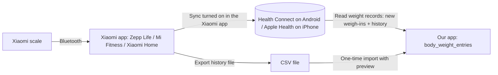

# 10 — Body Progress: Calorie Stats, Body Weight, BMI and Measurements

**Created:** October 20, 2026  
**Status:** Plan, no code  
**Builds on:** Epic J (body weight) in [01_user_story.md](../business_analyst/user_story/01_user_story.md) · Epic H (lifts) for strength progress  
**Related:** [03 outline](./03_fitness_app_outline.md) · [05 architecture](./05_architecture_outline.md) · [06 roadmap](./06_development_roadmap.md) · [09 pantry](./09_pantry_inventory.md)

> Numbers and formulas here are general fitness estimates for tracking trends, **not medical advice**.

---

## 1. What this adds

| Area | What I get |
|------|-----------|
| **Calorie stats** | Daily calorie intake is already the core of v1 (`08`). This adds weekly averages, trends, an **estimated maintenance (TDEE)** and a suggested target for my goal (cut / maintain / bulk) |
| **Body weight** | Log weight any day; see a smoothed trend instead of noisy daily numbers |
| **BMI and body ratios** | BMI from height + weight, plus **waist-to-height ratio**, which is more useful for someone who lifts |
| **Body measurements** | Arms, chest, shoulders, waist, hips, thighs, calves, neck, forearms, tracked over time per muscle group |
| **Progress view** | One place to see: weight trend, measurement changes, calories and strength side by side |

---

## 2. Calorie tracking and stats

### What exists vs what's new

| | Already planned (v1, Oct 31) | New here |
|---|---|---|
| Intake | Food log, eaten / goal / remaining on Today | Weekly average, 30-day chart, days on target |
| Goal | Calorie goal typed in Settings | **Suggested** goal from TDEE + chosen goal; I can still override |
| Burned | — (cardio calories are Epic I3, Could) | Optional manual "calories burned" from a watch or machine; never added back to the goal by default |
| Macros | Stored, no targets yet | Protein target in g/kg body weight (uses my latest weight) |

### Estimating maintenance (TDEE)

**Step 1: starting estimate** (before I have data). Mifflin-St Jeor BMR × activity level:

```
BMR (male)   = 10 × kg + 6.25 × cm − 5 × age + 5
BMR (female) = 10 × kg + 6.25 × cm − 5 × age − 161
TDEE         = BMR × activity (1.2 sedentary · 1.375 light · 1.55 moderate · 1.725 very active)
```

**Step 2: learned from my own data** (after 2+ weeks of logging food and weight). More accurate, because it uses what actually happened:

```
TDEE ≈ average daily intake − (weight trend change in kg × 7,700 ÷ days)
```

| Example (illustration only) | Value |
|---|---|
| 14-day average intake | 2,200 kcal |
| Weight trend | 70.0 → 69.6 kg (−0.4 kg) |
| Daily deficit | 0.4 × 7,700 ÷ 14 ≈ 220 kcal |
| **Learned TDEE** | **≈ 2,420 kcal** |

The app shows which estimate it's using, and only switches to the learned one when there are enough logged days (e.g. ≥ 12 of the last 14 days with food logged and ≥ 4 weigh-ins).

### Suggested target

| Goal | Target |
|------|--------|
| Cut | TDEE − 300 to 500 kcal (about 0.25–0.5 kg per week) |
| Maintain | TDEE |
| Lean bulk | TDEE + 200 to 300 kcal |

The suggestion is shown next to my current goal; it never changes the goal without me confirming.

---

## 3. Body weight

- Log kg on any day (one entry per day; a second entry that day replaces the first, or asks).
- **Trend line = 7-day moving average.** Daily weight swings 0.5–1.5 kg from water, salt and food in the gut; the average shows the real direction.
- Best practice tip in the app: weigh in the morning, after the bathroom, before eating.
- Weekly change and change since start shown in kg and %.

---

## 4. BMI and body ratios

### BMI

```
BMI = weight kg ÷ (height m)²
```

| Category | WHO (global) | Asia-Pacific (WHO 2000, often used in PH) |
|----------|--------------|--------------------------------------------|
| Underweight | < 18.5 | < 18.5 |
| Normal | 18.5 – 24.9 | 18.5 – 22.9 |
| Overweight | 25 – 29.9 | 23 – 24.9 (at risk) |
| Obese | ≥ 30 | ≥ 25 |

Setting: which scale to use (default **Asia-Pacific**, can switch).

**Example (illustration):** 70 kg, 170 cm → 70 ÷ 1.70² = **24.2**. Normal on the WHO scale, "at risk" on the Asia-Pacific scale.

### Why BMI isn't enough for a lifter

BMI can't tell muscle from fat, so building muscle can push BMI up while the waist goes down. The app always shows BMI **together with**:

| Ratio | Formula | Rule of thumb |
|-------|---------|---------------|
| **Waist-to-height** | waist cm ÷ height cm | Under 0.5 is generally healthy |
| Body fat % (Could) | US Navy estimate from neck, waist, height (+ hips for women) | Rough estimate; trend matters more than the number |

---

## 5. Body measurements (muscle sizes)

### Measurement sites

| Group | Site | Sides | How to measure |
|-------|------|-------|----------------|
| Upper | Neck | — | Below the Adam's apple |
| Upper | Shoulders | — | Widest point around both shoulders |
| Upper | Chest | — | Across the nipples, arms down, after a normal breath out |
| Arms | Upper arm (biceps) | L / R | Widest point; pick **flexed or relaxed** once and stay with it |
| Arms | Forearm | L / R | Widest point, arm straight |
| Core | Waist | — | At the navel, relaxed, after breathing out |
| Core | Hips | — | Widest point of the buttocks |
| Legs | Thigh | L / R | Widest point, standing |
| Legs | Calf | L / R | Widest point, standing |

I choose which sites I track (default: chest, waist, both arms, both thighs). Custom sites can be added.

**Start now:** a printable version of this guide, with a log sheet and a notes format, is in [guides/body_measurement_guide.md](../guides/body_measurement_guide.md).

### Consistency rules (shown as a guide in the app)

- Same time of day (morning, before eating), same tape, same spot.
- Tape snug on the skin, not pressing in.
- Measure twice; the app saves the average if the two differ.
- **Every 2–4 weeks** is enough. Muscles grow slowly; weekly numbers are mostly noise.
- Optional: a progress photo with each session (front / side / back), stored only on the phone.

### What the progress view shows

| View | Example |
|------|---------|
| Change since start / last session | Arms +1.2 cm · Waist −3.0 cm |
| Per group chart over time | Arms L vs R on one chart (shows imbalance) |
| Next to strength | Upper arm size next to my best curl / close-grip press (Epic H) |
| Next to weight | Waist and weight trend together (losing fat vs losing muscle) |

---

## 5b. Importing weight from my Xiaomi scale

I have a **Xiaomi Bluetooth scale**. The plan is to read its data **from the phone's health store or an export file, not from the scale itself**:

- **The scale only keeps a few readings** that haven't synced yet.
- **Xiaomi's Bluetooth protocol is not public.**
- **The full history lives in Xiaomi's app.** Depending on the model, that's **Zepp Life** (formerly Mi Fit; older Mi Smart Scale 2 / Mi Body Composition Scale 2), **Mi Fitness**, or **Xiaomi Home** (newer models such as the S400).



### Two routes

| Route | What it gives | When | Notes |
|-------|---------------|------|-------|
| **A. Health Connect / Apple Health sync** | New weigh-ins appear automatically; older history too, if Xiaomi's app has written it there | B1b | Needs an **EAS dev build** (native module, doesn't run in Expo Go). On Android, Health Connect lets an app read only the **last 30 days** by default; older data needs the extra **"read history"** permission (Android 14+), approved once |
| **B. Export file import (CSV)** | Full history in one go | B1 | Works offline in SQLite, no native module. Fallback if route A doesn't reach far enough back |

**Recommended:** do **B** once to bring in the full history, then **A** for everything after. Both write to the same table, so duplicates are skipped (see rules below).

### Setup to check on my phone (before Nov 11)

| Step | What to check | Why |
|------|---------------|-----|
| 1 | Which app my scale uses (Zepp Life, Mi Fitness or Xiaomi Home) | Decides the sync and export menus |
| 2 | In that app: **Settings → Third-party access / Health Connect / Apple Health**, and turn on weight sharing | Route A |
| 3 | Open Health Connect (Android: *Settings → Security & privacy → Privacy → Health Connect*) or Apple Health → see if **Weight** has my older entries | Shows how far back route A reaches |
| 4 | In the Xiaomi app, look for **Export data** (or the account's data download request) | Route B. If there's no export, route A plus manual entry is the fallback |

> Menu names differ between app versions and models. Verify on the phone; nothing here has been tested yet.

### Import rules

| Rule | Detail |
|------|--------|
| **Keep every reading** | A scale can record several weigh-ins a day. All are stored with their time |
| **Daily weight = first reading of the day** | Matches the "weigh in the morning" rule; used for the trend, BMI and TDEE. I can pick a different reading for a day |
| **No duplicates** | Same source record id, or same time (± 2 min) and weight (± 0.05 kg) → skipped |
| **Manual entries win** | If I typed a weight for a day, imports don't overwrite it |
| **Preview before saving** (CSV) | Shows the date range, number of readings and duplicates skipped; I confirm |
| **Units** | Converted to kg on import (jin or lb exports are converted) |
| **Other users** | If family members use the same scale, readings are often split by profile in Xiaomi's app. Import only my profile; flag readings more than 5 kg off my trend for review |
| **Body composition** | If the scale also gives body fat %, muscle mass or water %, import them as **estimates**: shown as trends only, never replacing tape measurements. Bioimpedance numbers change with hydration |

## 6. Phasing

Nothing new in the October sprint (`08` is locked). Weight and measurements can still be **written in notes from today** and pasted or entered later, so the trend has data from the start.

| Step | Scope | Stories | Size |
|------|-------|---------|------|
| **B1. Weight + BMI** | Body profile (height, sex, birth date, activity, goal, BMI scale); weight log; 7-day trend; BMI + category on a Progress screen; **CSV import of Xiaomi history** (§5b) | J1, J5, J6, J17 | ~2–3 days |
| **B1b. Scale sync** | Read weight (and body composition, if available) from Health Connect (Apple Health later, `11` §6); runs when the app opens | J18, J19 | ~2 days, needs an EAS dev build |
| **B2. Measurements** | Choose sites; measurement session form; history + change since start; waist-to-height | J7–J10 | ~3 days |
| **B3. Calorie stats** | Weekly averages, 30-day chart, learned TDEE, suggested target, protein g/kg. **Starting (formula) TDEE moved to first-run setup, build-plan feature 13 (Oct 20)** | J4, J11–J13 | ~3–4 days |
| **B4. Later (Could)** | Body fat % estimate, progress photos, strength-vs-size view, training/rest day goals (J3), smartwatch import | J3, J14–J16 | — |

### Proposed slot in the November / December plan (needs your OK)

B1 is small and **should start early**: the learned TDEE needs weeks of weight data. B2 and B3 fit best next to workouts in December.

| Dates | Work |
|-------|------|
| Nov 1–10 | Pantry P1–P3 (`09`) |
| **Nov 11–12** | **B1: weight + BMI** |
| Nov 13–23 | Pantry P4: recipes and batches |
| Nov 24–28 | Friends beta prep (`11`) |
| Nov 30 – Dec 13 | .NET API + sync + AI |
| December | Workouts, **B1b scale sync**, **B2 measurements**, **B3 calorie stats**; finance app after |

---

## 7. Stories (extends Epic J)

Priority: **Should** = v1.1 · **Could** = later. J1–J4 already exist in `01_user_story.md`.

| ID | Story | Priority |
|----|-------|----------|
| J5 | As me, I want to save my height, sex, birth date, activity level and goal once, so stats can be calculated | Should |
| J6 | As me, I want to see my BMI and its category (Asia-Pacific or WHO scale), shown together with waist-to-height when I have a waist measurement | Should |
| J7 | As me, I want to choose which body parts I measure (arms, chest, waist, thighs, etc.), with left and right sides | Should |
| J8 | As me, I want to log a measurement session (all chosen sites in one form, in cm) | Should |
| J9 | As me, I want to see each measurement's change since my first and my last session, per muscle group | Should |
| J10 | As me, I want a short guide on how to measure each site consistently | Should |
| J11 | As me, I want weekly and 30-day averages of calories and protein, and how many days I hit my goal | Should |
| J12 | As me, I want an estimated maintenance (TDEE), first from a formula, then learned from my logged food and weight | Should |
| J13 | As me, I want a suggested calorie and protein target for my goal (cut / maintain / bulk) that I confirm before it's used | Should |
| J14 | As me, I want an estimated body fat % from my measurements | Could |
| J15 | As me, I want to add progress photos to a measurement session, kept only on my phone | Could |
| J16 | As me, I want to see arm size next to my arm exercise strength over time | Could |
| J17 | As me, I want to import my weight history from my Xiaomi scale's export file, with a preview and no duplicates | Should |
| J18 | As me, I want new weigh-ins from my Xiaomi scale to appear automatically (via Health Connect or Apple Health), so I never type my weight | Should |
| J19 | As me, I want body fat % and muscle mass from my scale shown as estimate trends | Could |

### Acceptance criteria (core)

- **J1 / trend:** **Given** weigh-ins on 7 different days, **then** the trend shows the 7-day average and the change vs the previous week.
- **J6:** **Given** height 170 cm and latest weight 70 kg, **then** BMI shows 24.2. **Given** no height saved, **then** the app asks for it instead of showing BMI.
- **J8:** **Given** I enter arm L 34.0 and arm R 34.5, **then** both are saved for that date; sites I skip stay empty (no zero values).
- **J9:** **Given** a first waist of 84 cm and a latest of 81 cm, **then** waist shows −3.0 cm since start.
- **J12:** **Given** fewer than 12 logged food days or 4 weigh-ins in the last 14 days, **then** the formula estimate is used and labeled "estimate". Otherwise the learned value is used and labeled "from your data".
- **J13:** A suggested target never replaces my goal without a confirm tap.
- **J17:** **Given** an export file with 400 readings, 12 of which are already in the app, **then** the preview shows 388 new and 12 skipped, and nothing is saved until I confirm.
- **J18:** **Given** I weighed myself on the Xiaomi scale this morning and its app synced to Health Connect, **when** I open the app, **then** today's weight appears with source "Xiaomi scale" and the trend updates.
- **J18:** **Given** I already typed today's weight by hand, **then** the synced reading is stored but the manual one stays the day's weight.

---

## 8. Data model additions

| Table | Fields |
|-------|--------|
| `body_profile` (one row) | height_cm, sex, birth_date, activity_level, goal (`cut` / `maintain` / `bulk`), bmi_scale (`asia_pacific` / `who`), tracked_sites |
| `body_weight_entries` | id, measured_at (date + time), weight_kg, source (`manual` / `health_connect` / `apple_health` / `csv_import`), source_record_id?, is_daily_value, body_fat_pct?, muscle_kg?, water_pct?, note, created_at / updated_at |
| `import_runs` | id, source, file name?, started_at, readings found / added / skipped (for undoing a bad import) |
| `measurement_sessions` | id, measured_on, note, photo_uris? |
| `body_measurements` | id, session_id, site (enum + custom), side (`left` / `right` / `none`), value_cm, state (`relaxed` / `flexed`) |

Calculated, not stored: BMI, waist-to-height, trend, weekly averages, TDEE (cache later if slow). Stored in **kg and cm**; display units follow the units setting (`03` §10).

---

## 9. Screens

| Screen | Purpose | Step |
|--------|---------|------|
| Progress (tab) | Weight trend, BMI card, latest measurements, calorie averages | B1–B3 |
| Log weight sheet | Quick entry; also a shortcut on Today | B1 |
| Body profile | Height, sex, birth date, activity, goal, BMI scale | B1 |
| Measurement session | All chosen sites in one form, guide per site | B2 |
| Measurement history | Per site / per group charts, change since start | B2 |
| Calorie stats | Weekly / 30-day averages, TDEE, suggested target | B3 |

**Tabs:** with Pantry and Progress, five tabs plus Products is too many. Proposal: **Today · Log · Pantry · Progress · More** (More = Products, Recipes, Settings).

---

## 10. Definition of done

- [ ] Log weight in ≤ 2 taps from Today; trend shows the 7-day average
- [ ] BMI shows with its category and, when available, waist-to-height
- [ ] Log a full measurement session (6+ sites) in under 2 minutes
- [ ] Each site shows change since start and since last session
- [ ] Weekly calorie and protein averages are correct against the food log
- [ ] TDEE shows "estimate" or "from your data" correctly; suggested target needs a confirm
- [ ] JSON export includes body profile, weights and measurements

---

## 11. Risks

| Risk | Mitigation |
|------|------------|
| Daily weight swings feel discouraging | Trend line first; the raw daily number is secondary |
| BMI says "overweight" while I'm gaining muscle | Always shown next to waist-to-height and measurements |
| Measurements are inconsistent | Guide per site, flexed/relaxed fixed per site, every 2–4 weeks |
| Learned TDEE is off when logging is incomplete | Only used when enough days are logged; shows its source |
| Photos are sensitive | Stay on the phone; excluded from sync and export unless I opt in |

---

## 12. Open questions

| # | Question | Default if no answer |
|---|----------|----------------------|
| Q-B1 | cm or inches for measurements? | cm |
| Q-B2 | BMI scale: Asia-Pacific or WHO? | Asia-Pacific |
| Q-B3 | Arms measured flexed or relaxed? | Flexed |
| Q-B4 | Which sites to track at first? | Chest, waist, arms L/R, thighs L/R |
| Q-B5 | Want progress photos? | Not in the first version (Could) |
| Q-B6 | Smart scale? **Answered: Xiaomi Bluetooth scale** (§5b). Android (main phone). Still need: exact model + which app (Zepp Life / Mi Fitness / Xiaomi Home) | Health Connect (Android). Apple Health only if the iPhone version is unlocked (`11` §6) |
| Q-B7 | Approve the B1 slot on Nov 11–12 (shifts pantry recipes and the .NET API by 2 days)? | Use the proposed slot |
