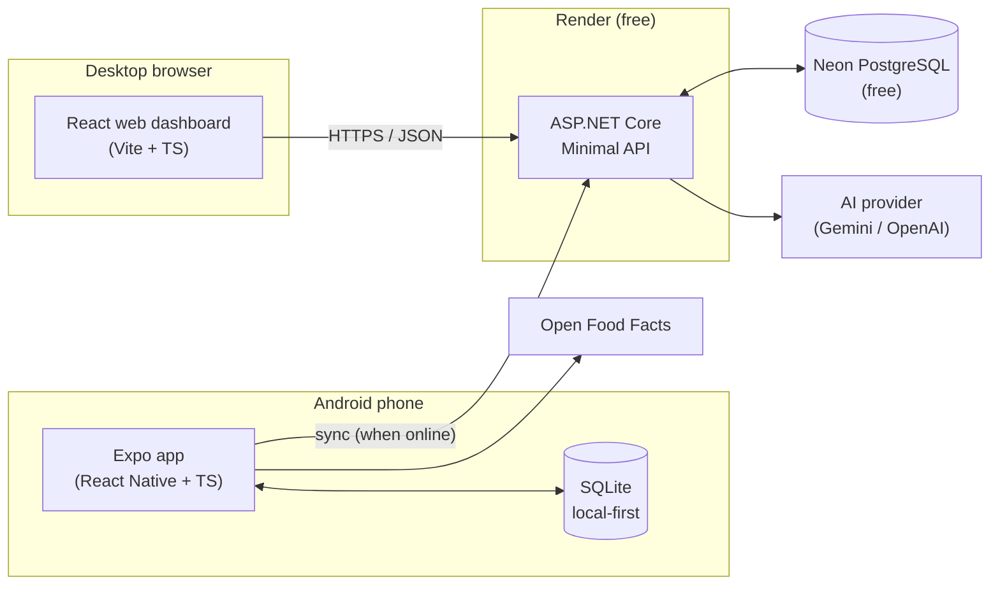
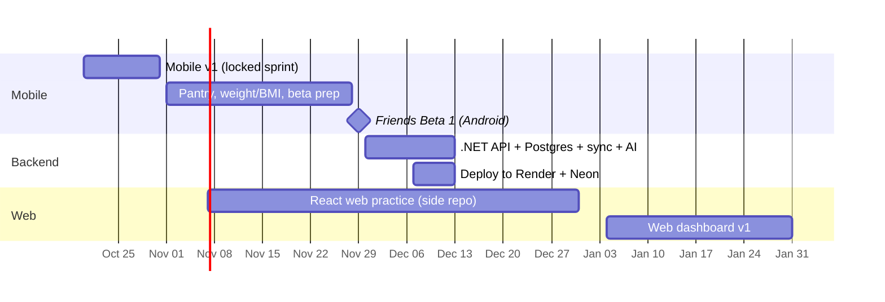

# 01 — Backend, Free Hosting, Web Version and Portfolio Plan

**Date:** October 20, 2026  
**Status:** Proposed (waiting on owner's OK)  
**Related:** [05 architecture](../plan/05_architecture_outline.md) · [06 roadmap](../plan/06_development_roadmap.md) · [07 .NET + React](../plan/07_recommendation_for_dotnet_react.md) · [08 October sprint](../plan/08_october_sprint.md) · [11 friends beta](../plan/11_ios_and_friends_beta.md)

---

## 1. Summary

| Question | Answer |
|----------|--------|
| Backend: .NET or Node? | **ASP.NET Core Minimal API** (C#) |
| Where to host it for free? | **Render** (API, Docker) + **Neon** (PostgreSQL) |
| Mobile or web first? | **Mobile first.** Web dashboard in **January**, after the API exists |
| How to build the web version? | **Separate React (Vite) app** on the same .NET API, not Expo web |
| Portfolio | Public repo with README, demo video, APK release, tests + CI, live API docs, web dashboard link |

Nothing here changes the **locked October sprint** (`08` §1). All of it starts after v1.0 (Oct 31).

---

## 2. Target architecture

**One API, two clients.** The phone keeps working offline. The server is for sync, AI and the web dashboard, and logging never needs it.

---

## 3. Backend: .NET vs Node

| | .NET Minimal API | Node (Express / Hono + TS) |
|---|---|---|
| Speed for me | Fast: EF Core, FluentValidation, DI are familiar | Slower: new runtime, ORM and patterns |
| Type sharing with the app | Generate TS types from OpenAPI (`openapi-typescript` or NSwag) | Share the same `zod` schemas directly |
| Learning load | One new thing (React) | Two new things at once (React + Node backend) |
| Free hosting | Fewer options (Docker or Azure) | More (Cloudflare Workers, Vercel) |
| Portfolio story | "React Native + React + .NET + Postgres" full stack | JS-only, hides my strongest skill |

**Decision (proposed):** .NET. Node can be a separate learning project later, but not on this project's critical path.

---

## 4. Free hosting ($0)

| Use | Pick | Alternatives | Notes |
|-----|------|--------------|-------|
| .NET API | **Render free web service** (Docker) | Azure App Service F1; Koyeb free | Sleeps after ~15 min idle → first request ~30–60 s. OK because the app is local-first |
| PostgreSQL | **Neon free** (~0.5 GB, scales to zero) | Supabase free (500 MB, pauses after ~1 week idle) | Avoid Render free Postgres (expires after ~30 days) |
| Web dashboard | **Vercel** or **Cloudflare Pages** | Netlify | Static Vite build, free |
| Crash reports | Sentry free | — | Already in `11` |
| CI | GitHub Actions | — | Free for public repos |
| Skip ($0 budget) | Google Cloud Run, Oracle Always Free | — | Need a credit card |
| Not free anymore | Fly.io, Railway | — | — |

> Free tiers change often. Check the current limits before signing up.

### Prep checklist (December)

- [ ] Create Render and Neon accounts
- [ ] `GET /health` endpoint
- [ ] Dockerfile (`mcr.microsoft.com/dotnet/aspnet` base). Try Native AOT for faster cold starts
- [ ] Secrets (DB connection string, AI key) only in Render env vars; commit `.env.example`
- [ ] EF Core migrations, **additive only**, run from CI or at startup
- [ ] OpenAPI + Swagger/Scalar page enabled in production (portfolio)
- [ ] CORS allows the web dashboard's domain only

---

## 5. Mobile first, web later

### Why mobile first

| Reason | Detail |
|--------|--------|
| The core feature is the phone | Barcode scanning, logging at the table, offline. Camera and local DB are weak on the web |
| Daily use from Oct 23 | Daily use finds the bugs. Switching now restarts the plan |
| Web needs the API | A website can't read the phone's SQLite. It needs API + Postgres + login (December) |
| Locked decision | `08` §1. Not reopened this sprint |

### How to build the web version

| Option | Verdict |
|--------|---------|
| A. Expo web (`react-native-web`, same codebase) | ❌ SQLite and barcode scanning are weak on the web; looks like "mobile on desktop"; teaches less web React |
| B. **Separate React web app** (Vite + React Router + TanStack Query) on the .NET API | ✅ Real web React skills, desktop-first UI, shows "one API, two clients" |

### What the web dashboard does (v1, January)

| In | Out (stays on mobile) |
|----|-----------------------|
| Sign in (same account as Beta 2) | Barcode scanning |
| Calorie and macro history, weekly averages | Offline logging |
| Weight trend, BMI, measurements charts | Health Connect scale sync |
| Product library and recipe management (big screen) | |
| Read-only food log by day (editing later) | |

It also gives iPhone friends something to use while iOS is parked (`11` §6).

---

## 6. Timeline

**Practice early, without risk:** on free weekends, build a small Vite + React app in a **separate repo** (e.g. an Open Food Facts search page). It doesn't touch the sprint, and the January work starts with the basics already learned.

---

## 7. Portfolio plan

Repo: `github.com/Alxbry28/MyFitnessTrackingApp` (public, MIT).

| Priority | Item | When |
|----------|------|------|
| 1 | **README**: problem → solution, screenshots/GIF, architecture diagram, stack, links to ADRs | Minimal on Oct 31, full in Nov |
| 2 | **Demo video** (1–2 min: scan → log → Today) | Oct 31 |
| 3 | **APK on GitHub Releases** (`v1.0` tag) | Oct 31 |
| 4 | **Unit tests on calculations** + **CI badge** (typecheck, lint, Jest, `dotnet test`) | Nov |
| 5 | Branches + PRs with clear descriptions (after the sprint's "work on main" rule ends) | From Nov 30 |
| 6 | **Live API docs** (Swagger/Scalar on Render) | Dec |
| 7 | **Live web dashboard link** with a demo account | Jan |

### Planning docs as a showcase

`1_docs/` (user stories, ADRs, sprint plan, roadmap) shows process, which few portfolio projects do. Keep it, and:
- Fix the inconsistencies in §8 so the docs agree with each other.
- Say plainly that the BA and tech-lead roles were AI-assisted.

### Public repo hygiene

| Risk | Rule |
|------|------|
| Personal health data (real weight in `BUGS.md`, JSON exports, screenshots) | `.gitignore` exports and a `personal/` folder; screenshots use **demo seed data** |
| Secrets (Neon, AI key, Sentry DSN) | Env vars / EAS secrets only; commit `.env.example` |
| Render cold start | README note: "free tier, may take ~1 min to wake up" |
| Polish delays v1 | No portfolio work before Oct 31 beyond a minimal README |

---

## 8. Doc review findings (Oct 20)

| # | Finding | Severity | Fix |
|---|---------|----------|-----|
| 1 | No app code yet; `08` Day 1 (scaffold) is behind | High | Do scaffold + data layer on Oct 20; keep the Oct 23 start; use the Oct 30 buffer |
| 2 | `05` §1 stack still "TBD"; §2, §7–§10 still describe Supabase + Edge Functions, against `07` / `08` | High | Update to Expo → .NET API → Postgres (+ web client) |
| 3 | `06` Phase 6–7 still use the Supabase Edge Function AI proxy | Medium | Same |
| 4 | ADR-2 to ADR-5 still Proposed while coding starts | Medium | Owner accepts or changes them |
| 5 | Sync needs `updated_at` and `deleted_at` (soft delete) on synced tables, or phone deletes never reach the server | Medium | Add both columns in the Oct 20 schema |
| 6 | Migration runner doesn't say how it tracks versions | Low | `PRAGMA user_version`; additive only; export before each migration |
| 7 | Restore is only a stretch goal while daily use starts Oct 23 | Low | Copy the JSON export to Google Drive weekly until restore exists |
| 8 | AI free tiers may train on prompts; not OK for friends' health data | Low (Beta 2) | Paid tier with a monthly cost cap before Beta 2 |

---

## 9. Proposed ADRs

To add to `05` §13 once the owner approves.

| # | Decision | Rationale | Status |
|---|----------|-----------|--------|
| ADR-14 | Backend is ASP.NET Core Minimal API, not Node | Owner's strength; full-stack portfolio story; OpenAPI codegen covers type sharing | Proposed |
| ADR-15 | Hosting: Render (API, Docker) + Neon (Postgres), free tiers | $0, no credit card; cold starts OK because the app is local-first | Proposed |
| ADR-16 | Every synced table has `updated_at` and `deleted_at` (soft delete) | Last-write-wins sync and delete propagation | Proposed |
| ADR-17 | Public repo: no personal data or secrets in git; demo seed data for screenshots | The repo is public as a portfolio piece | Proposed |
| ADR-18 | Web client is a separate React (Vite) app on the .NET API, built after the API (January) | Web React skills; desktop-first UI; one API, two clients | Proposed |

---

## 10. Open questions for the owner

| # | Question |
|---|----------|
| Q-T1 | Accept ADR-2 to ADR-5? |
| Q-T2 | Approve ADR-14 to ADR-18 and add them to `05` §13? |
| Q-T3 | OK to update `05` and `06` to remove Supabase Edge Functions and add the web client? |
| Q-T4 | Web dashboard in January, as in §6? |
| Q-T5 | Web scope in §5: read-only food log first, or editing from day one? (for the BA) |
