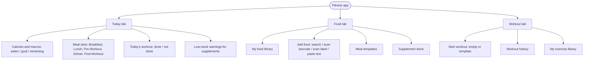
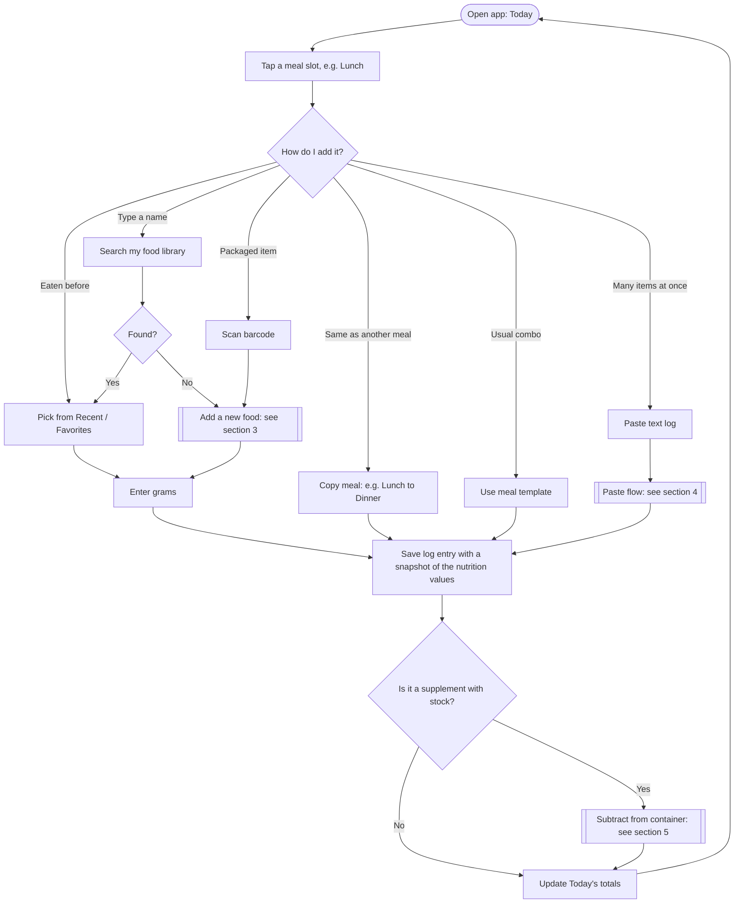
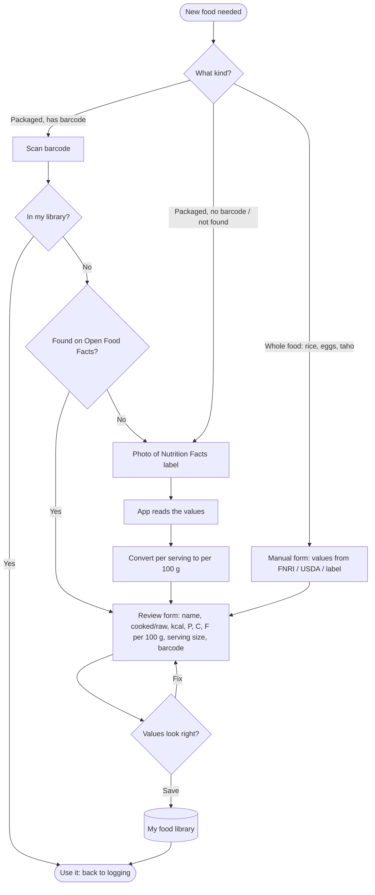
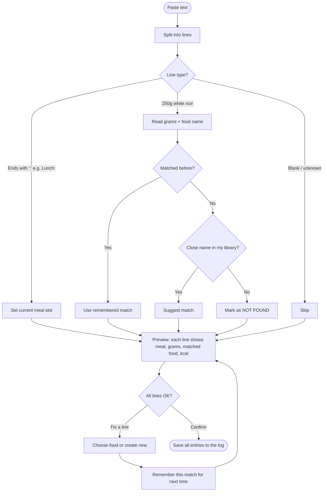
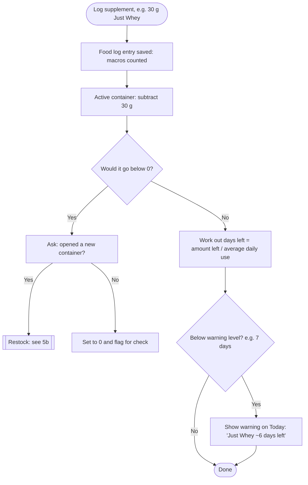
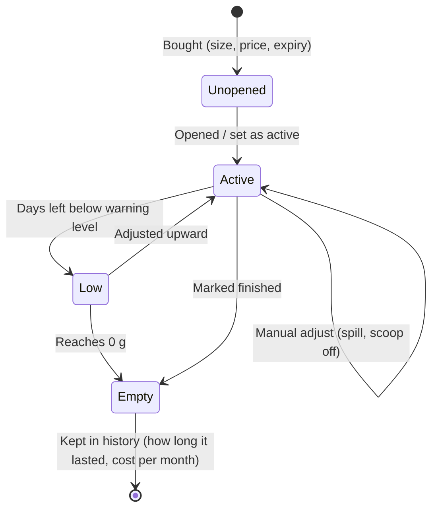
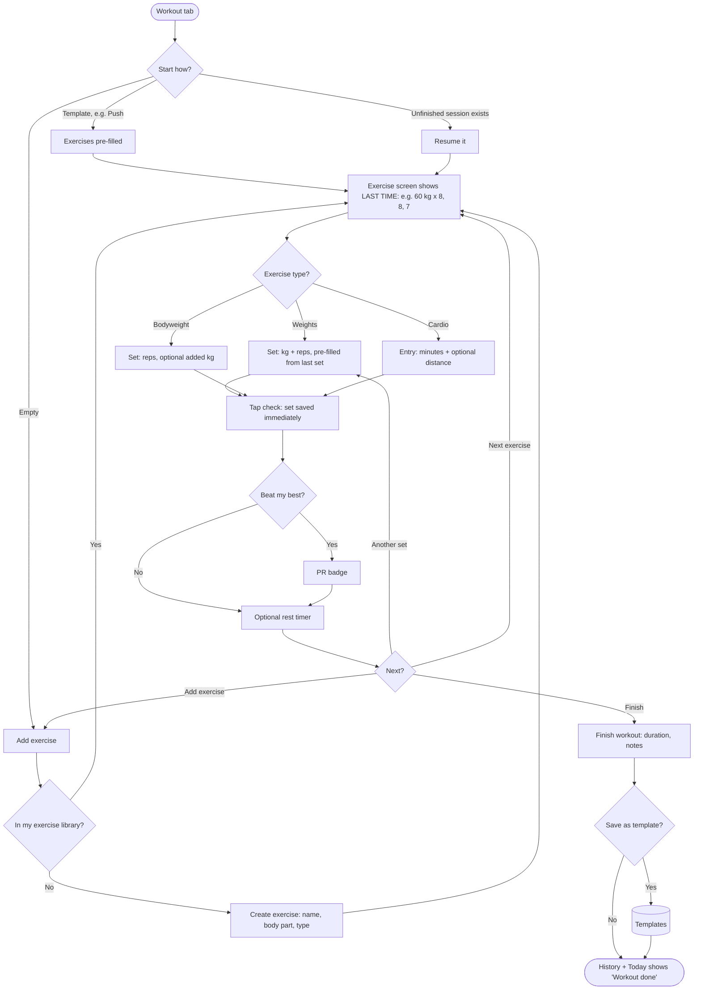
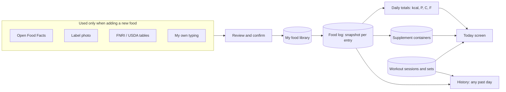
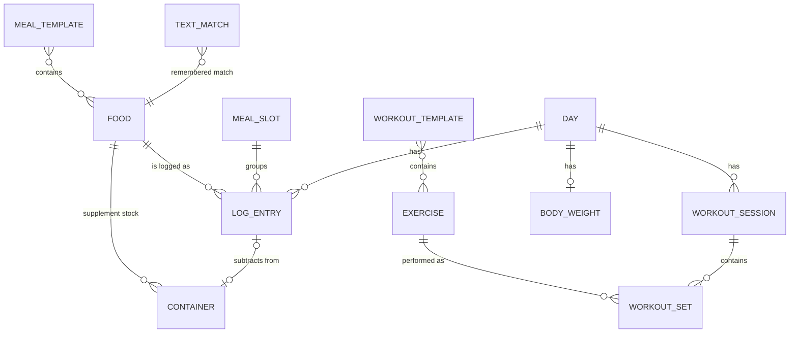
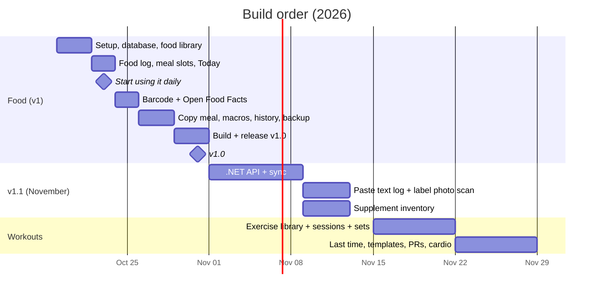

# Workflow Diagrams — Personal Fitness Tracker

**Date:** October 19, 2026
**Status:** Draft, no code
**Goes with:** [01_user_story.md](./01_user_story.md) (story IDs like `B3`, `H2` and `K2` refer to that file)

> **Viewing the diagrams:** they're written in Mermaid. They render automatically on GitHub. In VS Code, install the **"Markdown Preview Mermaid Support"** extension, then open the preview (`Ctrl+Shift+V`).

---

## Contents

1. [The big picture](#1-the-big-picture)
2. [Daily food logging](#2-daily-food-logging)
3. [Adding a new food (barcode, label, manual)](#3-adding-a-new-food)
4. [Paste my text log](#4-paste-my-text-log)
5. [Supplement inventory](#5-supplement-inventory)
6. [Workout session (lifts and cardio)](#6-workout-session)
7. [Where the numbers come from](#7-where-the-numbers-come-from)
8. [How the data fits together](#8-how-the-data-fits-together)
9. [Build timeline](#9-build-timeline)

---

## 1. The big picture

Three tabs. **Today** is the home screen and pulls everything together.

---

## 2. Daily food logging

The everyday path. The goal is **3 taps or fewer plus the grams** for a food I've eaten before (B4), and **2 taps** to copy a meal (B3).

---

## 3. Adding a new food

Every new food goes through this **once**. After that it lives in my library and the stored numbers are always used (R1). **Nothing is saved without the review step.**

**When each path arrives**

| Path | October v1 | November |
|------|-----------|----------|
| Manual form | ✅ | ✅ |
| Barcode + Open Food Facts | ✅ | ✅ |
| Label photo | ❌ (type it in manually) | ✅ via the .NET API and AI vision (R4) |

---

## 4. Paste my text log

This reads the same text I used to give ChatGPT, using simple rules (R3). It needs no AI and no internet.

**Example**

| Pasted line | Meal slot | Grams | Matched to |
|-------------|-----------|-------|------------|
| `Breakfast:` | Breakfast | | |
| `220g taho` | Breakfast | 220 | Taho |
| `250g boiled chicken breast` | Lunch | 250 | Chicken breast, cooked |
| `5g creatine` | Pre-Workout | 5 | Creatine monohydrate (also subtracted from stock) |

---

## 5. Supplement inventory

A supplement is a normal food (for macros) **plus** a container (for stock). Logging it does both jobs (R8).

### 5a. Normal use

### 5b. Container life cycle

**Edits and deletes:** if I delete or change a supplement log entry, the container gets the difference back (K acceptance criteria).

---

## 6. Workout session

Every set is saved **straight away**, so closing the app at the gym loses nothing (R6). "Last time" numbers are always shown (H2).

---

## 7. Where the numbers come from

Outside sources only **fill in** my library. Totals are always worked out from **my** data, which fixes ChatGPT's "different numbers every day" and lost-memory problems.

---

## 8. How the data fits together

A conceptual view of what the app remembers. **Not a database design**; the field-level design comes later.

| Thing | What it holds (in plain words) |
|-------|-------------------------------|
| Food | Name, cooked/raw, brand, barcode, kcal/P/C/F per 100 g, optional serving size |
| Log entry | Day, meal slot, food, grams, **copy of the values at the time of logging** |
| Meal slot | My own names and order (Breakfast … Post-Workout) |
| Meal template | A saved group of foods + grams |
| Text match | "boiled chicken breast" → my food "Chicken breast, cooked" |
| Container | Supplement, size, grams left, price, opened date, expiry, status |
| Exercise | Name, body part, type (weights / bodyweight / cardio) |
| Workout session | Date, start/finish time, notes |
| Workout set | Exercise, set number, kg, reps (or minutes / distance for cardio) |
| Body weight | Date, kg |

---

## 9. Build timeline

Based on [plan/08](../plan/08_october_sprint.md), with the changes suggested in [01_user_story.md §5](./01_user_story.md#5-recommendations).

