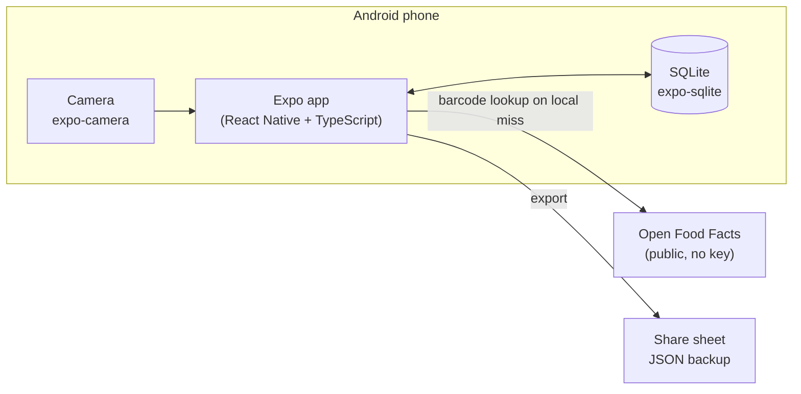
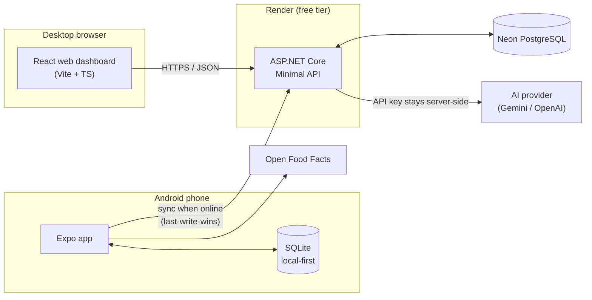
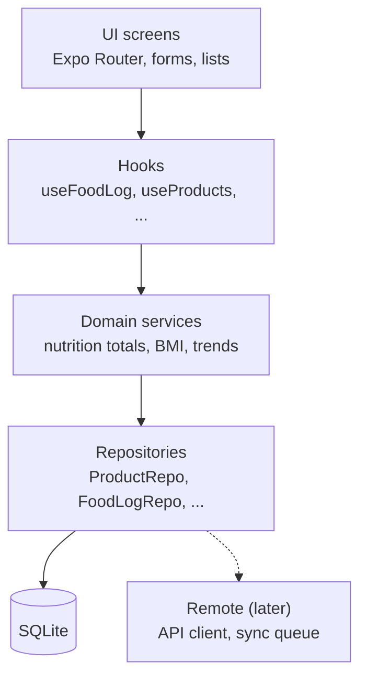
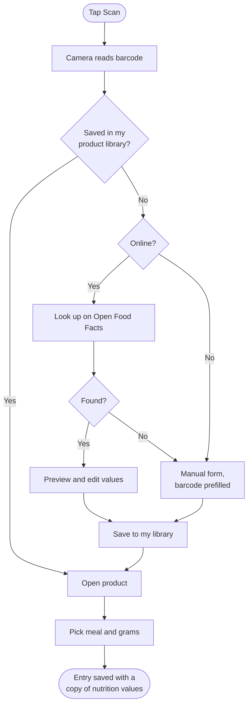
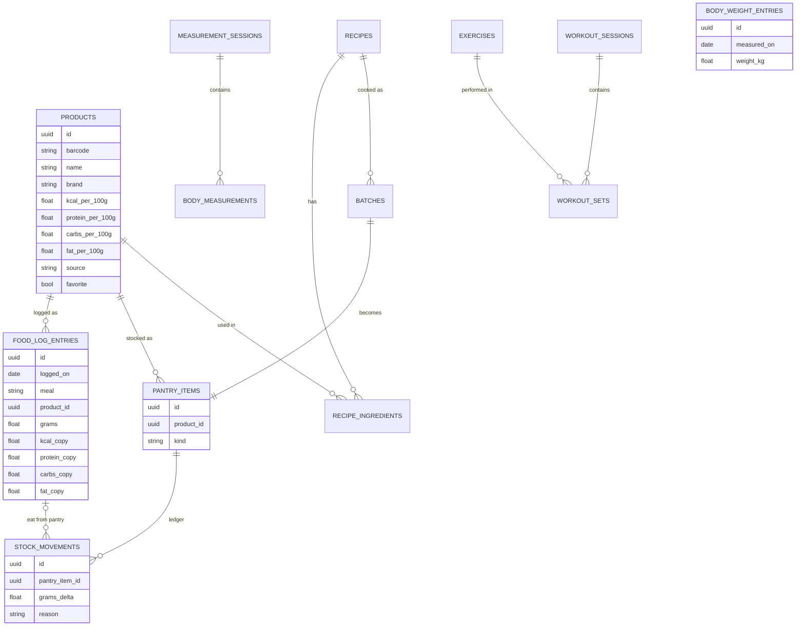
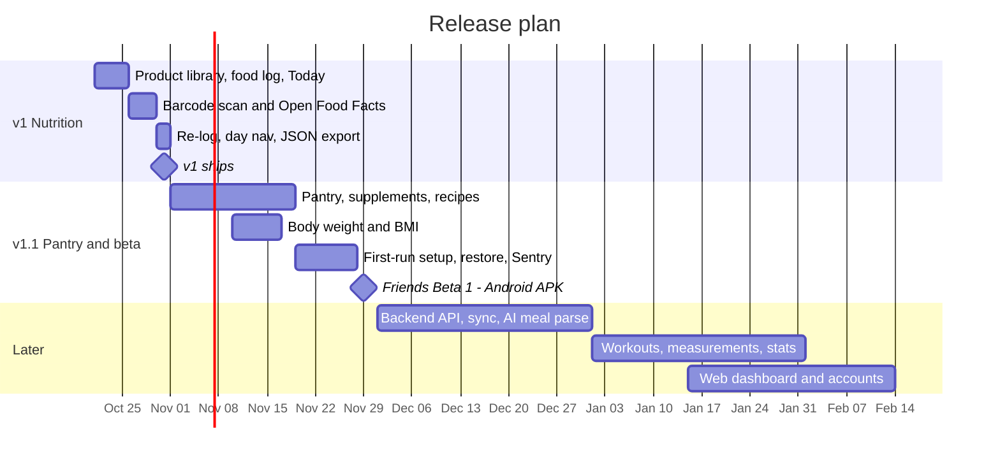

# MyFitnessTrackingApp

A personal, **local-first** fitness tracker for Android. Scan a grocery barcode,
save *your* product once with *your* numbers, and log a meal in a few taps. It
works offline, remembers everything, and grows into pantry inventory, body
progress, workouts, and AI help.

It replaces a MyFitnessPal + ChatGPT routine: MyFitnessPal is cluttered with
wrong foods, and ChatGPT has no memory and can't scan a barcode.

> **Status:** planning complete, app not scaffolded yet. v1 (nutrition) is due
> **Oct 31, 2026**. See the [build plan](blueprint/build-plan.md).

---

## Core principles

1. **Log fast**: barcode scan, recents, favorites, one-tap re-log
2. **Offline-first**: daily logging never needs the network
3. **My data, my products**: scanned items live in my own database, and my edits win
4. **AI assists, I decide**: AI output is always previewed and confirmed before saving
5. **Start small**: ship a thin slice, use it daily, then deepen

---

## Architecture

### Today (v1 and Friends Beta 1)

Everything runs on the phone. There is no server and no account. Open Food Facts
is only called when a scanned barcode isn't already saved.



### Later (Beta 2, December onward)

One API, two clients. The phone keeps working offline. The server is only for
sync, AI, and the web dashboard.



### App layers

Screens never talk to storage or the network directly. Everything goes through
repositories, so offline storage and later sync stay consistent.



---

## Key flow: scan to logged

Target: from scan to a saved log entry in **under 30 seconds**.



---

## Data model

Local SQLite now, mirrored to PostgreSQL once sync exists. Every table uses UUID
ids plus `created_at` / `updated_at`.



**Data rules**

| Rule | Why |
|------|-----|
| Nutrition is stored per 100 g, and log entries keep a **copy** of the values | Editing a product never rewrites history |
| Pantry stock is the **sum of stock movements**, not an editable number | History, undo, and a waste report for free |
| Buying or cooking never changes daily macros; only food log entries do | Buying isn't eating |
| Body data is stored in kg and cm; BMI, trends, and TDEE are calculated | One source of truth; units only change display |
| Migrations are additive and never wipe data | People use the app daily on real data |

---

## Roadmap



| Release | Scope |
|---------|-------|
| **v1** (Oct 31) | Product library, food log by meal, Today screen, barcode scanner, Open Food Facts lookup, recents and favorites, day navigation, JSON export |
| **v1.1** (November) | Pantry and groceries, canned and opened items, supplements, recipes and cooked batches, body weight and BMI, first-run setup, backup restore, crash reports |
| **Later** | .NET API and sync, AI meal parsing, workouts, body measurements, calorie stats, Health Connect scale sync, web dashboard, accounts |

The full numbered list lives in [blueprint/build-plan.md](blueprint/build-plan.md).

---

## Tech stack

| Area | Choice |
|------|--------|
| App | Expo, React Native, TypeScript, Expo Router (Android only for now) |
| Local data | `expo-sqlite` with an additive migration runner |
| Forms and validation | `react-hook-form` + `zod` |
| Barcode | `expo-camera` + [Open Food Facts](https://world.openfoodfacts.org/) |
| Backup | `expo-sharing` (JSON export) |
| Build | EAS Build, Android APK (preview profile) |
| Later: API | ASP.NET Core Minimal API + EF Core on Render, Neon PostgreSQL |
| Later: AI | Gemini or OpenAI, called only through the API |
| Later: web | Vite + React Router + TanStack Query on Vercel or Cloudflare Pages |
| Later: monitoring | Sentry (no food or body data in reports) |
| Later: exercise art | [Workout Guide](https://github.com/bryllim/workout-guide) by Bryl Lim, based on [Everkinetic](https://github.com/everkinetic/data) (CC BY-SA 4.0) |

Budget is **$0**: free tiers only. iPhone is parked until there's budget for
the Apple Developer Program; the code stays cross-platform.

---

## Getting started

The app isn't scaffolded yet. Once it is, these are the planned commands:

```bash
npm install
npx expo start            # open on the phone with Expo Go
npx expo start --android  # launch on a connected Android device or emulator
npx expo lint             # lint
npx tsc --noEmit          # typecheck
eas build -p android --profile preview   # shareable APK
```

---

## Repository layout

```text
.
├── 1_docs/          # planning history: plans, user stories, ADRs, tech lead notes
├── blueprint/       # workflow: project plan, build plan, current spec, history
├── specs/           # database and design specs
├── .agents/ .claude/ # AI workflow skills (AI Blueprint)
├── AGENTS.md        # instructions for AI coding agents
└── README.md
```

Planned app structure once scaffolded:

```text
app/                 # Expo Router screens: Today, Log, Products, Settings
src/
├── components/      # shared UI
├── modules/fitness/ # repositories, services, types, pantry
├── db/              # SQLite schema and migrations
└── lib/             # utils, theme, constants
```

---

## Documentation

| Topic | Where |
|-------|-------|
| Project plan (summary) | [blueprint/project-plan.md](blueprint/project-plan.md) |
| Build plan | [blueprint/build-plan.md](blueprint/build-plan.md) |
| Architecture and ADRs | [1_docs/plan/05_architecture_outline.md](1_docs/plan/05_architecture_outline.md) |
| October sprint | [1_docs/plan/08_october_sprint.md](1_docs/plan/08_october_sprint.md) |
| Pantry inventory | [1_docs/plan/09_pantry_inventory.md](1_docs/plan/09_pantry_inventory.md) |
| Body progress | [1_docs/plan/10_body_progress.md](1_docs/plan/10_body_progress.md) |
| Friends beta | [1_docs/plan/11_ios_and_friends_beta.md](1_docs/plan/11_ios_and_friends_beta.md) |
| User stories and workflows | [1_docs/business_analyst/user_story/](1_docs/business_analyst/user_story/) |
| Backend, hosting, portfolio | [1_docs/tech_lead/01_backend_hosting_web_and_portfolio.md](1_docs/tech_lead/01_backend_hosting_web_and_portfolio.md) |

---

## Privacy

The repo is public, so no personal health data, exports, or real screenshots
are committed. Progress photos stay on the device. In Friends Beta 1, each
tester's data never leaves their phone.

Calorie, BMI, and TDEE numbers are estimates, not medical advice.

---

## License

[MIT](LICENSE) © 2026 Alex Bryan Arellano
