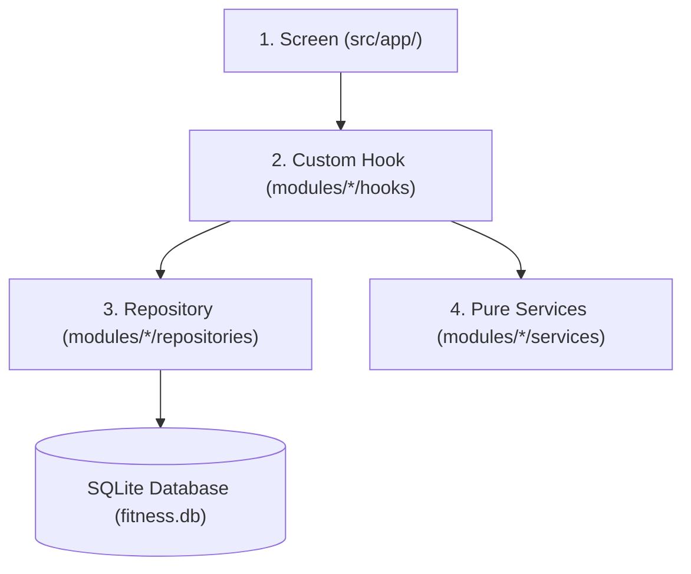
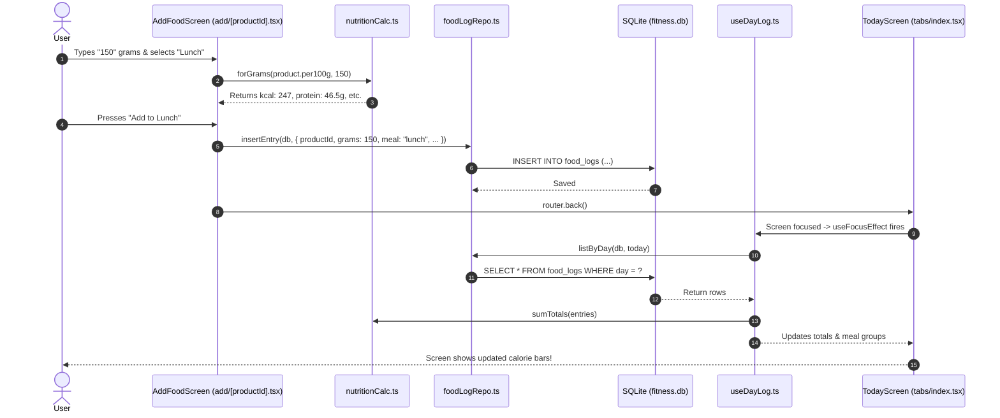

# Mobile App Codebase Walkthrough (Beginner-Friendly Guide)

Welcome to the **MyFitnessTrackingApp** mobile application codebase! This guide is written specifically to help you understand how this app is structured, how all the pieces fit together, and how data flows from the screen to the database.

---

## 1. What is this App?

This mobile application (located in [`apps/mobile/`](file:///c:/Users/Bryan/Desktop/mine/1_personal/draft/fitness_app/apps/mobile)) is a **local-first, offline-ready Android fitness tracker**.

Instead of relying on cloud servers or subscription-based services, this app stores **all data directly on the user's phone** in a local SQLite database.

### Key Capabilities:
- **Calorie & Macro Tracking:** Daily calorie targets, protein/carbs/fat breakdown, and meal logs (Breakfast, Lunch, Dinner, Snack).
- **Barcode Scanner:** Uses phone camera to instantly find products in your local library or fetch nutritional info from OpenFoodFacts.
- **Personal Product Library:** Keep your own foods and recipes with exact per-100g nutritional info.
- **Pantry Inventory:** Track what food you actually have in your kitchen, portions left, expiration dates, and log meals directly from your pantry.
- **Body & Weight Progress:** Track body weight history, body profile goals, and progress over time.
- **Text & AI Meal Logging:** Paste unstructured text or meal notes and have the app parse and log them into meals.
- **Local Backup & Restore:** Export and import full data backups in JSON format to files on your device.

---

## 2. Tech Stack at a Glance

The app is built with modern React Native and the Expo ecosystem:

| Technology | Purpose | Where to find it |
| :--- | :--- | :--- |
| **React 19 & React Native 0.86** | Core UI library & mobile primitives (`View`, `Text`, `Pressable`, `ScrollView`). | [`package.json`](file:///c:/Users/Bryan/Desktop/mine/1_personal/draft/fitness_app/apps/mobile/package.json) |
| **Expo SDK 57** | Framework providing native mobile capabilities (Camera, SQLite, Filesystem, Sensors). | [`app.json`](file:///c:/Users/Bryan/Desktop/mine/1_personal/draft/fitness_app/apps/mobile/app.json) |
| **Expo Router** | File-based routing system (similar to Next.js on the web). Folders and files define screens! | [`src/app/`](file:///c:/Users/Bryan/Desktop/mine/1_personal/draft/fitness_app/apps/mobile/src/app) |
| **Expo SQLite** | Embedded relational SQL database running entirely on the phone. | [`src/db/client.ts`](file:///c:/Users/Bryan/Desktop/mine/1_personal/draft/fitness_app/apps/mobile/src/db/client.ts) |
| **Expo Camera** | Native hardware barcode scanner. | [`src/app/scan.tsx`](file:///c:/Users/Bryan/Desktop/mine/1_personal/draft/fitness_app/apps/mobile/src/app/scan.tsx) |
| **Zod** | Schema definition and data validation. | [`src/modules/nutrition/services/productSchema.ts`](file:///c:/Users/Bryan/Desktop/mine/1_personal/draft/fitness_app/apps/mobile/src/modules/nutrition/services/productSchema.ts) |
| **TypeScript** | Strict type safety across the entire application. | [`tsconfig.json`](file:///c:/Users/Bryan/Desktop/mine/1_personal/draft/fitness_app/apps/mobile/tsconfig.json) |

---

## 3. High-Level Folder Structure

Here is how the project files are organized inside [`apps/mobile/src/`](file:///c:/Users/Bryan/Desktop/mine/1_personal/draft/fitness_app/apps/mobile/src):

```text
apps/mobile/
├── package.json          # Dependencies & scripts
├── app.json              # Expo configuration (app name, icons, permissions)
├── AGENTS.md             # Development conventions & Expo rules
└── src/
    ├── app/              # Presentation Layer: Screens & navigation routes (Expo Router)
    │   ├── _layout.tsx   # Root navigation shell & database initialization
    │   ├── (tabs)/       # The bottom tab bar screens (Today, Log, Pantry, Progress, More)
    │   ├── add/          # Screens for adding food items to meals
    │   ├── pantry/       # Screens for pantry item details & logging portions
    │   ├── scan.tsx      # Barcode scanner screen
    │   └── ...           # Other modal & secondary screens
    │
    ├── db/               # Database Layer: SQLite setup & versioned migrations
    │   ├── client.ts     # Database connection & migration runner
    │   └── migrations/   # Incremental SQL migration scripts (001 to 009)
    │
    ├── modules/          # Domain Feature Modules (Clean Architecture)
    │   ├── nutrition/    # Calorie tracking, food logs, products, macros
    │   ├── pantry/       # Pantry stock, portions, inventory
    │   ├── body/         # Weight history, body profile & setup
    │   └── backup/       # JSON export & restore engine
    │
    ├── lib/              # Shared Utilities & Infrastructure
    │   ├── theme/        # Color palette, spacing, typography & theme hooks
    │   └── openFoodFacts.ts # API client for fetching product info by barcode
    │
    └── components/       # App-wide UI components
        └── StartupStatus.tsx # Fallback screens during initial loading or error
```

---

## 4. The 4-Layer Architecture Pattern

Every feature in [`src/modules/`](file:///c:/Users/Bryan/Desktop/mine/1_personal/draft/fitness_app/apps/mobile/src/modules) follows a predictable, clean separation of concerns.



### The 4 Layers Explained:

1. **Screen (`src/app/`)**:
   - What the user sees and touches.
   - Handles layout, buttons, scrolling, and user gestures.
   - Calls hooks to fetch data and trigger actions.
   - *Example:* [`TodayScreen`](file:///c:/Users/Bryan/Desktop/mine/1_personal/draft/fitness_app/apps/mobile/src/app/(tabs)/index.tsx#L17)

2. **Custom Hook (`modules/*/hooks/`)**:
   - Manages component state (`useState`), side effects (`useEffect`), and screen focus (`useFocusEffect`).
   - Calls the repository for database access and provides clean variables to the screen (e.g. `loading`, `entries`, `retry`, `remove`).
   - *Example:* [`useDayLog`](file:///c:/Users/Bryan/Desktop/mine/1_personal/draft/fitness_app/apps/mobile/src/modules/nutrition/hooks/useDayLog.ts#L17)

3. **Repository (`modules/*/repositories/`)**:
   - The **only** place where SQL statements (`SELECT`, `INSERT`, `UPDATE`, `DELETE`) are written.
   - Transforms raw database rows into strongly-typed TypeScript objects.
   - *Example:* [`foodLogRepo.ts`](file:///c:/Users/Bryan/Desktop/mine/1_personal/draft/fitness_app/apps/mobile/src/modules/nutrition/repositories/foodLogRepo.ts)

4. **Service (`modules/*/services/`)**:
   - Pure business logic, calculations, and data validation.
   - **No UI, no React, and no database queries here!** This makes calculations easy to test and 100% bug-free.
   - *Example:* [`forGrams`](file:///c:/Users/Bryan/Desktop/mine/1_personal/draft/fitness_app/apps/mobile/src/modules/nutrition/services/nutritionCalc.ts#L9) and [`macroTargets`](file:///c:/Users/Bryan/Desktop/mine/1_personal/draft/fitness_app/apps/mobile/src/modules/nutrition/services/nutritionCalc.ts#L34)

---

## 5. Walkthrough: From Launch to Rendering

When you start the app on your phone, what happens under the hood?

### Step 1: The App Enters [`RootLayout`](file:///c:/Users/Bryan/Desktop/mine/1_personal/draft/fitness_app/apps/mobile/src/app/_layout.tsx#L12)
- React Native loads [`_layout.tsx`](file:///c:/Users/Bryan/Desktop/mine/1_personal/draft/fitness_app/apps/mobile/src/app/_layout.tsx).
- It wraps everything inside [`GestureHandlerRootView`](file:///c:/Users/Bryan/Desktop/mine/1_personal/draft/fitness_app/apps/mobile/src/app/_layout.tsx#L16) so swipe gestures work smoothly.
- It initializes [`SQLiteProvider`](file:///c:/Users/Bryan/Desktop/mine/1_personal/draft/fitness_app/apps/mobile/src/app/_layout.tsx#L19) with `databaseName="fitness.db"`.

### Step 2: Running Migrations ([`migrateDbIfNeeded`](file:///c:/Users/Bryan/Desktop/mine/1_personal/draft/fitness_app/apps/mobile/src/db/client.ts#L8))
- Before any screen can display data, Expo SQLite calls [`migrateDbIfNeeded`](file:///c:/Users/Bryan/Desktop/mine/1_personal/draft/fitness_app/apps/mobile/src/db/client.ts#L8).
- It enables foreign keys: `PRAGMA foreign_keys = ON`.
- It checks SQLite's internal version: `PRAGMA user_version`.
- If new migration files exist in [`src/db/migrations/`](file:///c:/Users/Bryan/Desktop/mine/1_personal/draft/fitness_app/apps/mobile/src/db/migrations), it runs each migration inside a safe database transaction.
- While this happens, React Suspense displays [`StartupLoading`](file:///c:/Users/Bryan/Desktop/mine/1_personal/draft/fitness_app/apps/mobile/src/components/StartupStatus.tsx).

### Step 3: Mounting Navigation Stack & Tabs
- Once the database is ready, Expo Router renders the [`Stack`](file:///c:/Users/Bryan/Desktop/mine/1_personal/draft/fitness_app/apps/mobile/src/app/_layout.tsx#L20) navigator.
- The default screen is `(tabs)` ([`TabLayout`](file:///c:/Users/Bryan/Desktop/mine/1_personal/draft/fitness_app/apps/mobile/src/app/(tabs)/_layout.tsx#L17)).
- The bottom tab bar renders 5 tabs:
  1. **Today** ([`index.tsx`](file:///c:/Users/Bryan/Desktop/mine/1_personal/draft/fitness_app/apps/mobile/src/app/(tabs)/index.tsx))
  2. **Log** ([`log.tsx`](file:///c:/Users/Bryan/Desktop/mine/1_personal/draft/fitness_app/apps/mobile/src/app/(tabs)/log.tsx))
  3. **Pantry** ([`pantry.tsx`](file:///c:/Users/Bryan/Desktop/mine/1_personal/draft/fitness_app/apps/mobile/src/app/(tabs)/pantry.tsx))
  4. **Progress** ([`progress.tsx`](file:///c:/Users/Bryan/Desktop/mine/1_personal/draft/fitness_app/apps/mobile/src/app/(tabs)/progress.tsx))
  5. **More** ([`more.tsx`](file:///c:/Users/Bryan/Desktop/mine/1_personal/draft/fitness_app/apps/mobile/src/app/(tabs)/more.tsx))

---

## 6. Walkthrough: Tracing a Real Feature (Logging a Meal)

Let's follow what happens when a user logs a 150g Chicken Breast for Lunch:



### Detailed Breakdown of this Flow:
1. **Screen Input**: The user is on [`add/[productId].tsx`](file:///c:/Users/Bryan/Desktop/mine/1_personal/draft/fitness_app/apps/mobile/src/app/add/[productId].tsx).
2. **Instant Calculation**: As the user types `150`, [`forGrams`](file:///c:/Users/Bryan/Desktop/mine/1_personal/draft/fitness_app/apps/mobile/src/modules/nutrition/services/nutritionCalc.ts#L9) recalculates the calories and macros in real-time without querying the database again.
3. **Save to DB**: When tapping save, [`insertEntry`](file:///c:/Users/Bryan/Desktop/mine/1_personal/draft/fitness_app/apps/mobile/src/modules/nutrition/repositories/foodLogRepo.ts) writes a new row to the `food_logs` table.
4. **Auto-refresh**: When returning to the Today screen, [`useDayLog`](file:///c:/Users/Bryan/Desktop/mine/1_personal/draft/fitness_app/apps/mobile/src/modules/nutrition/hooks/useDayLog.ts) triggers its [`useFocusEffect`](file:///c:/Users/Bryan/Desktop/mine/1_personal/draft/fitness_app/apps/mobile/src/modules/nutrition/hooks/useDayLog.ts#L39) hook to immediately refresh the list of meals and the progress bar.
5. **Undo Support**: If the user accidentally deletes an item, [`useDayLog`](file:///c:/Users/Bryan/Desktop/mine/1_personal/draft/fitness_app/apps/mobile/src/modules/nutrition/hooks/useDayLog.ts#L56-L80) provides a 5-second undo snackbar that can restore the entry.

---

## 7. Deep-Dive into the Core Modules

### 🥗 Nutrition Module (`src/modules/nutrition/`)
- **Purpose:** Everything related to calories, macronutrients, products, and meal logs.
- **Key Files:**
  - [`productRepo.ts`](file:///c:/Users/Bryan/Desktop/mine/1_personal/draft/fitness_app/apps/mobile/src/modules/nutrition/repositories/productRepo.ts): Search products, lookup barcodes, save custom foods.
  - [`foodLogRepo.ts`](file:///c:/Users/Bryan/Desktop/mine/1_personal/draft/fitness_app/apps/mobile/src/modules/nutrition/repositories/foodLogRepo.ts): Manage daily food diary entries, soft-delete, restore, meal totals.
  - [`nutritionCalc.ts`](file:///c:/Users/Bryan/Desktop/mine/1_personal/draft/fitness_app/apps/mobile/src/modules/nutrition/services/nutritionCalc.ts): Pure math functions: scale macros per gram, sum totals, format grams and kcal with commas.
  - [`pasteLog.ts`](file:///c:/Users/Bryan/Desktop/mine/1_personal/draft/fitness_app/apps/mobile/src/modules/nutrition/services/pasteLog.ts): Parses text formatted food logs (e.g., copied from an AI chat or notes app).

### 🥫 Pantry Module (`src/modules/pantry/`)
- **Purpose:** Inventory tracking of physical products in the kitchen.
- **Key Concepts:**
  - Tracks items with total package weight and portions remaining.
  - Supports **drained weight** (e.g. canned tuna or chickpeas where liquid weight differs from food weight).
  - When you log a portion from the pantry to a meal, the app automatically deducts stock from the pantry item in a single database transaction.
- **Key Files:**
  - [`pantryRepo.ts`](file:///c:/Users/Bryan/Desktop/mine/1_personal/draft/fitness_app/apps/mobile/src/modules/pantry/repositories/pantryRepo.ts): Add pantry items, update portions, deduct weight, check expiration.
  - [`pantry.tsx`](file:///c:/Users/Bryan/Desktop/mine/1_personal/draft/fitness_app/apps/mobile/src/app/(tabs)/pantry.tsx): Main pantry screen.

### ⚖️ Body & Progress Module (`src/modules/body/`)
- **Purpose:** Weight tracking and body profile setup.
- **Key Concepts:**
  - Calculates goal weight dates, weekly change rates, and target calories.
  - Includes a CSV/history importer ([`import-weight.tsx`](file:///c:/Users/Bryan/Desktop/mine/1_personal/draft/fitness_app/apps/mobile/src/app/import-weight.tsx)) to bring past weight data from other apps.
- **Key Files:**
  - [`weightRepo.ts`](file:///c:/Users/Bryan/Desktop/mine/1_personal/draft/fitness_app/apps/mobile/src/modules/body/repositories/weightRepo.ts): CRUD operations for daily weight measurements.
  - [`bodyProfileRepo.ts`](file:///c:/Users/Bryan/Desktop/mine/1_personal/draft/fitness_app/apps/mobile/src/modules/body/repositories/bodyProfileRepo.ts): Height, biological sex, birth date, target weight.

### 💾 Backup & Restore Module (`src/modules/backup/`)
- **Purpose:** Data portability and backup without a cloud account.
- **Key Capabilities:**
  - Exports the entire SQLite database into an open JSON file format.
  - Shares the JSON file using native Android share sheet ([`expo-sharing`](file:///c:/Users/Bryan/Desktop/mine/1_personal/draft/fitness_app/apps/mobile/package.json#L22)).
  - Allows picking a JSON file ([`expo-document-picker`](file:///c:/Users/Bryan/Desktop/mine/1_personal/draft/fitness_app/apps/mobile/package.json#L15)) and atomically restoring the database inside a transaction.
- **Key Files:**
  - [`exportBackup.ts`](file:///c:/Users/Bryan/Desktop/mine/1_personal/draft/fitness_app/apps/mobile/src/modules/backup/services/exportBackup.ts)
  - [`restoreBackup.ts`](file:///c:/Users/Bryan/Desktop/mine/1_personal/draft/fitness_app/apps/mobile/src/modules/backup/services/restoreBackup.ts)

---

## 8. Styling & Design System

The app does **not** use heavy UI libraries or Tailwind. Instead, it uses standard React Native [`StyleSheet.create`](file:///c:/Users/Bryan/Desktop/mine/1_personal/draft/fitness_app/apps/mobile/src/app/(tabs)/index.tsx#L19) paired with an intentional design token system:

- **Tokens:** Located in [`tokens.ts`](file:///c:/Users/Bryan/Desktop/mine/1_personal/draft/fitness_app/apps/mobile/src/lib/theme/tokens.ts). Defines:
  - Color palettes (`dark` and `light` modes)
  - Font sizes (`xs: 11`, `sm: 13`, `md: 15`, `lg: 20`, `xl: 28`, `num: 34`)
  - Spacing scale (`space[1]` through `space[6]`)
  - Touch targets (`tap = 48dp` for accessibility)
- **Theme Hook:** [`useTheme`](file:///c:/Users/Bryan/Desktop/mine/1_personal/draft/fitness_app/apps/mobile/src/lib/theme/useTheme.ts) reads the phone's color scheme (or manual setting) and returns the current colors and styles.

---

## 9. Important Conventions to Remember

If you are modifying or extending this codebase, keep these core rules in mind:

1. **Keep Services Pure**: Don't import `react`, `expo-sqlite`, or UI components inside `src/modules/*/services/`. Services should be simple TypeScript functions that take input and return output.
2. **All SQL Stays in Repositories**: Don't run SQL queries directly inside React components or hooks. Put them in `src/modules/*/repositories/` so they are reusable and easy to audit.
3. **Always Run Expo Commands with `npx expo install`**: Never use bare `npm install <package>` for native Expo libraries. `npx expo install` ensures that the installed library version matches Expo SDK 57.
4. **Use `useFocusEffect` for Screens**: In tabbed navigation, screens don't always unmount when you navigate away. Use `useFocusEffect` to refresh data whenever the user switches back to a tab.

---

## 10. Developer Commands Cheatsheet

Run all of these commands from the `apps/mobile/` folder:

```bash
# 1. Start the development server (Scan QR code with Expo Go on your Android phone)
npx expo start

# 2. Start directly on a connected Android phone or emulator
npx expo start --android

# 3. Check for TypeScript errors across the whole project
npx tsc --noEmit

# 4. Run the linter to catch formatting and code style issues
npx expo lint

# 5. Diagnose dependency or Expo configuration issues
npx expo-doctor
```
