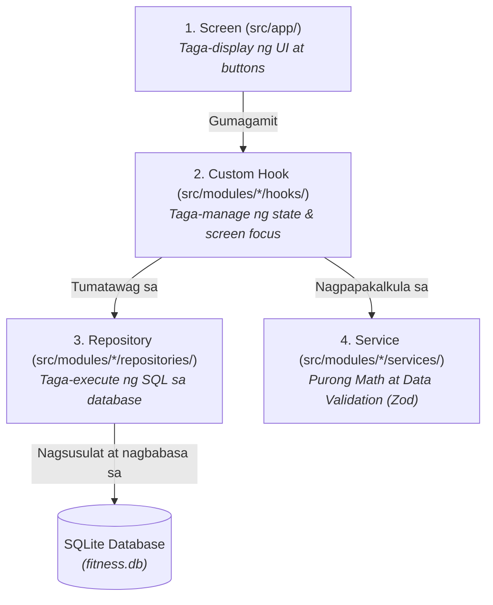

# Transformation Guide: From Vanilla React Native to This Architecture
*(Gabay para sa mga Beginner: Paano nagbago ang karaniwang React Native app papunta sa architecture na ito)*

Kung bago ka sa React Native, malamang ang nakasanayan mo ay ang karaniwang tutorial setup: isang `App.tsx`, mga inline styles, `AsyncStorage` para sa pag-save ng data, o kaya direct API calls gamit ang `fetch()`.

Ipinapaliwanag ng dokumentong ito kung **bakit** at **paano** binago ang application na ito mula sa karaniwang beginner setup patungo sa isang malinis, matatag, at **offline-first production architecture**.

---

## 1. Quick Comparison: Before vs. After

| Bahagi / Aspeto | Karaniwang Beginner React Native (Before) | Paano Ginawa sa App na Ito (After) |
| :--- | :--- | :--- |
| **Navigation** | Manu-manong `Stack.Navigator` at `<NavigationContainer>` sa isang malaking configuration file. | **Expo Router** sa [`src/app/`](file:///c:/Users/Bryan/Desktop/mine/1_personal/draft/fitness_app/apps/mobile/src/app). Folder at file names ang mismong routes. |
| **Data Storage** | `AsyncStorage` (mabagal, walang relations) o Cloud DB (Firebase/Supabase) na hindi gumagana offline. | **Local SQLite** ([`src/db/client.ts`](file:///c:/Users/Bryan/Desktop/mine/1_personal/draft/fitness_app/apps/mobile/src/db/client.ts)). Mabilis, relational, 100% offline-ready. |
| **Database Schema** | Walang version control sa tables; kapag nagbago ang data structure, nasisira ang saved data. | **Versioned Migrations** sa [`src/db/migrations/`](file:///c:/Users/Bryan/Desktop/mine/1_personal/draft/fitness_app/apps/mobile/src/db/migrations) gamit ang `PRAGMA user_version`. |
| **Code Structure** | Sabog sa isang file: SQL/fetch, formula ng calories, at UI ay magkakasama sa loob ng screen component. | **4-Layer Architecture**: Screen ➔ Hook ➔ Repository ➔ Service ([`src/modules/`](file:///c:/Users/Bryan/Desktop/mine/1_personal/draft/fitness_app/apps/mobile/src/modules)). |
| **Business Logic** | Nakahalo sa JSX o `onClick` handlers. Mahirap i-test at madaling magkaroon ng computation bugs. | **Pure Services** (hal. [`nutritionCalc.ts`](file:///c:/Users/Bryan/Desktop/mine/1_personal/draft/fitness_app/apps/mobile/src/modules/nutrition/services/nutritionCalc.ts)) na walang React o UI dependencies. |
| **Styling** | Hardcoded hex colors (`#ff7a1a`), random font sizes, at inline styles (`style={{ marginTop: 10 }}`). | **Design Tokens System** ([`tokens.ts`](file:///c:/Users/Bryan/Desktop/mine/1_personal/draft/fitness_app/apps/mobile/src/lib/theme/tokens.ts)) na may Dark/Light mode at 48dp minimum touch targets. |

---

## 2. Visual Architecture Diagram

### Before (Karaniwang Spaghetti Setup)
```text
┌────────────────────────────────────────────────────────┐
│ Screen Component (e.g., TodayScreen.tsx)               │
│ - useState para sa lahat ng data                       │
│ - direct SQL o fetch('https://api...')                 │
│ - inline math computations (kcal * grams / 100)        │
│ - JSX Layout + hardcoded styles                        │
└────────────────────────────────────────────────────────┘
```
*Problema:* Kapag may binago kang kulay o layout, baka masira ang computation. Kapag nag-crash ang API, magka-crash buong UI.

---

### After (Ang Ginawang 4-Layer Transformation)


---

## 3. Ang 6 na Yugto ng Transpormasyon

### Yugto 1: Paglipat sa Expo Router (File-Based Routing)
Sa lumang paraan, kailangan mong gumawa ng hiwalay na `navigation/RootNavigator.tsx` at manu-manong i-register ang bawat screen name.

**Ang Naging Pagbabago:**
Ginamit ang **Expo Router** sa [`src/app/`](file:///c:/Users/Bryan/Desktop/mine/1_personal/draft/fitness_app/apps/mobile/src/app):
- Ang file na [`src/app/(tabs)/index.tsx`](file:///c:/Users/Bryan/Desktop/mine/1_personal/draft/fitness_app/apps/mobile/src/app/(tabs)/index.tsx) ay awtomatikong naging home tab ("Today").
- Ang file na [`src/app/scan.tsx`](file:///c:/Users/Bryan/Desktop/mine/1_personal/draft/fitness_app/apps/mobile/src/app/scan.tsx) ay awtomatikong naging barcode scan screen.
- Ang bracket notation tulad ng [`src/app/product/[id].tsx`](file:///c:/Users/Bryan/Desktop/mine/1_personal/draft/fitness_app/apps/mobile/src/app/product/[id].tsx) ay dynamic parameter route (e.g. `/product/123`).
- Ang [`src/app/_layout.tsx`](file:///c:/Users/Bryan/Desktop/mine/1_personal/draft/fitness_app/apps/mobile/src/app/_layout.tsx) ang nagsisilbing master layout kung saan sinisimulan ang database.

---

### Yugto 2: Pagtatayo ng Offline-First SQLite at Migrations
Hindi sapat ang simpleng `AsyncStorage` kapag may relasyon ang mga datos mo (halimbawa: *ang isang Pantry Item ay konektado sa isang Product, at ang Food Log ay may reference sa Pantry Item*).

**Ang Naging Pagbabago:**
1. **SQLite Client Setup:** Sa [`src/db/client.ts`](file:///c:/Users/Bryan/Desktop/mine/1_personal/draft/fitness_app/apps/mobile/src/db/client.ts), gumamit ng `SQLiteProvider` mula sa `expo-sqlite`.
2. **Deterministic Migrations:** Sa halip na manu-manong mag-run ng `CREATE TABLE`, gumawa ng migration pipeline sa [`src/db/migrations/`](file:///c:/Users/Bryan/Desktop/mine/1_personal/draft/fitness_app/apps/mobile/src/db/migrations):
   - [`001_init.ts`](file:///c:/Users/Bryan/Desktop/mine/1_personal/draft/fitness_app/apps/mobile/src/db/migrations/001_init.ts) ➔ Gawa ng `products` table.
   - [`002_food_log.ts`](file:///c:/Users/Bryan/Desktop/mine/1_personal/draft/fitness_app/apps/mobile/src/db/migrations/002_food_log.ts) ➔ Gawa ng `food_logs` table.
   - [`007_pantry.ts`](file:///c:/Users/Bryan/Desktop/mine/1_personal/draft/fitness_app/apps/mobile/src/db/migrations/007_pantry.ts) ➔ Gawa ng `pantry_items` table.
   - Ginagamit ang SQLite `PRAGMA user_version`. Kapag binuksan ang app, tinitingnan nito kung anong migration number na ang tapos; kung may bago, ligtas itong patatakbuhin sa loob ng transaction.

---

### Yugto 3: Pagbubukod ng Repositories mula sa UI
Sa karaniwang beginner code, madalas ganito ang nakikita sa screen:
```tsx
// ❌ LUMANG PARAAN (Nakahalo ang database sa React screen)
export default function LogScreen() {
  const [data, setData] = useState([]);
  
  useEffect(() => {
    db.runAsync("SELECT * FROM food_logs").then(rows => setData(rows));
  }, []);
  // ...
}
```

**Ang Naging Pagbabago:**
Inilipat ang lahat ng database code sa **Repositories**:
- Tingnan ang [`src/modules/nutrition/repositories/foodLogRepo.ts`](file:///c:/Users/Bryan/Desktop/mine/1_personal/draft/fitness_app/apps/mobile/src/modules/nutrition/repositories/foodLogRepo.ts).
- Ang repository lamang ang nakikipag-usap sa SQLite:
  ```typescript
  //  BAGONG PARAAN (Nakatago ang SQL sa Repository)
  export async function listByDay(db: SQLiteDatabase, day: string): Promise<FoodLogEntry[]> {
    return await db.getAllAsync<EntryRow>(
      `SELECT ${COLUMNS} FROM food_logs WHERE day = ? AND deleted_at IS NULL ORDER BY logged_at ASC`,
      [day]
    );
  }
  ```
- Resulta: Kung kailangan mong baguhin ang SQL column o table name balang araw, **isang file lang ang gagalawin mo**, hindi ang lahat ng screen.

---

### Yugto 4: Paglikha ng Pure Services para sa Math at Validation
Ang computation ng calories ay kritikal:
- Formula: `(kcalPer100g * grams) / 100`
- Macro distribution: 30% Protein, 40% Carbs, 30% Fat.

**Ang Naging Pagbabago:**
Inilagay ang lahat ng math sa [`src/modules/nutrition/services/nutritionCalc.ts`](file:///c:/Users/Bryan/Desktop/mine/1_personal/draft/fitness_app/apps/mobile/src/modules/nutrition/services/nutritionCalc.ts):
- Walang `import React` o `import { View }`.
- Purong mga function tulad ng [`forGrams`](file:///c:/Users/Bryan/Desktop/mine/1_personal/draft/fitness_app/apps/mobile/src/modules/nutrition/services/nutritionCalc.ts#L9) at [`sumTotals`](file:///c:/Users/Bryan/Desktop/mine/1_personal/draft/fitness_app/apps/mobile/src/modules/nutrition/services/nutritionCalc.ts#L19).
- Dahil purong TypeScript functions ang mga ito, puwede itong lagyan ng automated unit tests nang hindi kailangang mag-render ng phone screen.

---

### Yugto 5: Paggamit ng Custom Hooks bilang "Kable" (Bridge)
Paano kumokonekta ang Screen sa Repository nang hindi nagiging makalat?
Sa pamamagitan ng **Custom Hooks** tulad ng [`useDayLog`](file:///c:/Users/Bryan/Desktop/mine/1_personal/draft/fitness_app/apps/mobile/src/modules/nutrition/hooks/useDayLog.ts).

**Ano ang Ginagawa ng Hook?**
1. **Auto-refresh sa Navigation:** Gamit ang [`useFocusEffect`](file:///c:/Users/Bryan/Desktop/mine/1_personal/draft/fitness_app/apps/mobile/src/modules/nutrition/hooks/useDayLog.ts#L39) ng Expo Router, sa tuwing babalik ang user mula sa ibang screen, kusa nitong kukunin ang pinakabagong entries.
2. **Soft Delete at Undo:** Kapag nag-delete ang user ng pagkain, hindi ito agad binubura permanently. Nagbibigay ang hook ng 5-second window para sa "Undo" button ([`useDayLog.ts:L46-L49`](file:///c:/Users/Bryan/Desktop/mine/1_personal/draft/fitness_app/apps/mobile/src/modules/nutrition/hooks/useDayLog.ts#L46-L49)).
3. **State Management:** Nagbibigay ito ng malilinis na status flags: `loading`, `ready`, at `error`.

Ang Screen ([`src/app/(tabs)/index.tsx`](file:///c:/Users/Bryan/Desktop/mine/1_personal/draft/fitness_app/apps/mobile/src/app/(tabs)/index.tsx#L22)) ay tumatawag na lamang ng isang linya:
```tsx
const log = useDayLog(today);
```

---

### Yugto 6: Pag-alis ng Hardcoded Styling (Design Tokens)
Sa halip na magsulat ng kung anu-anong kulay sa iba't ibang components, gumawa ng centralized design system sa [`src/lib/theme/`](file:///c:/Users/Bryan/Desktop/mine/1_personal/draft/fitness_app/apps/mobile/src/lib/theme):
- **[`tokens.ts`](file:///c:/Users/Bryan/Desktop/mine/1_personal/draft/fitness_app/apps/mobile/src/lib/theme/tokens.ts):**
  - May predefined colors para sa `dark` at `light` theme.
  - May predefined font scale (`fontSize.xs`, `sm`, `md`, `lg`, `xl`, `num`).
  - May `tap = 48` (48dp minimum touch target para laging madaling pindutin ang buttons).
- **[`useTheme.ts`](file:///c:/Users/Bryan/Desktop/mine/1_personal/draft/fitness_app/apps/mobile/src/lib/theme/useTheme.ts):**
  - Dynamic hook na tinitingnan ang settings ng phone upang awtomatikong magpalit ng tema.

---

## 4. Konkretong Halimbawa: "Bago" vs "Pagkatapos"

Tingnan natin kung paano nag-iba ang pagsusulat ng pag-save ng pagkain:

### 🔴 BEFORE (Beginner Approach)
```tsx
// Isang malaking component kung saan nakahalo ang lahat
export default function AddMeal() {
  const [name, setName] = useState("");
  const [grams, setGrams] = useState(100);
  
  const save = async () => {
    // 1. Math calculation sa loob ng click handler
    const kcal = (165 * grams) / 100;
    
    // 2. Direct database execution
    await db.execAsync(`INSERT INTO food VALUES ('${name}', ${kcal})`);
    
    alert("Saved!");
  };

  return (
    <View style={{ padding: 20, backgroundColor: "#fff" }}>
      <TextInput onChangeText={setName} />
      <Button title="Save" onPress={save} />
    </View>
  );
}
```

### 🟢 AFTER (Ang Ginawang Transformation sa App na Ito)
1. **Service:** Kinakalkula ang nutrisyon gamit ang [`forGrams`](file:///c:/Users/Bryan/Desktop/mine/1_personal/draft/fitness_app/apps/mobile/src/modules/nutrition/services/nutritionCalc.ts#L9).
2. **Schema:** Bina-validate ang input gamit ang Zod sa [`entrySchema.ts`](file:///c:/Users/Bryan/Desktop/mine/1_personal/draft/fitness_app/apps/mobile/src/modules/nutrition/services/entrySchema.ts).
3. **Repository:** Ligtas na ini-insert gamit ang parameterized SQL sa [`foodLogRepo.ts`](file:///c:/Users/Bryan/Desktop/mine/1_personal/draft/fitness_app/apps/mobile/src/modules/nutrition/repositories/foodLogRepo.ts#L88).
4. **Pantry Auto-deduct:** Kung galing sa pantry ang item, awtomatikong ibinabawas ang timbang sa imbentaryo sa loob ng iisang database transaction.
5. **Screen:** Ang UI sa [`add/[productId].tsx`](file:///c:/Users/Bryan/Desktop/mine/1_personal/draft/fitness_app/apps/mobile/src/app/add/[productId].tsx) ay nakapokus lamang sa pagpapakita ng magagandang cards at buttons.

---

## 5. Payo para sa mga Beginners na Nais Sumunod sa Ganitong Setup

Kung gagawa ka ng susunod mong React Native app, sundin ang mga prinsipyong ito:

1. **Huwag maglagay ng SQL o Fetch sa Screen Components:**
   - Gumawa ng `repositories/` folder. Doon mo ilagay lahat ng queries mo.
2. **Ihiwalay ang Math at Business Logic:**
   - Gumawa ng `services/` folder. Ang functions doon ay dapat tumatanggap lang ng arguments at nagbabalik ng resulta (walang UI).
3. **Piliin ang Offline-First:**
   - Mas magiging mabilis at maaasahan ang mobile app kapag nasa phone ang data gamit ang SQLite kaysa laging naghihintay ng internet signal.
4. **Gamitin ang Versioned Migrations:**
   - Huwag basta baguhin ang table. Gumawa ng migration file (`001`, `002`, `003`) para hindi mabura ang data ng users mo kapag nag-update ang app.
5. **Gamitin ang Design Tokens:**
   - Huwag mag-hardcode ng colors tulad ng `"#ff0000"`. Gumawa ng `theme/tokens.ts` para isang palitan lang kapag gusto mong mag-rebrand o magdagdag ng Dark Mode.
